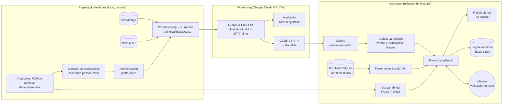
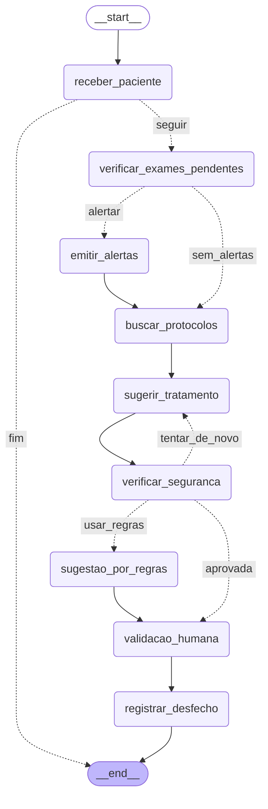
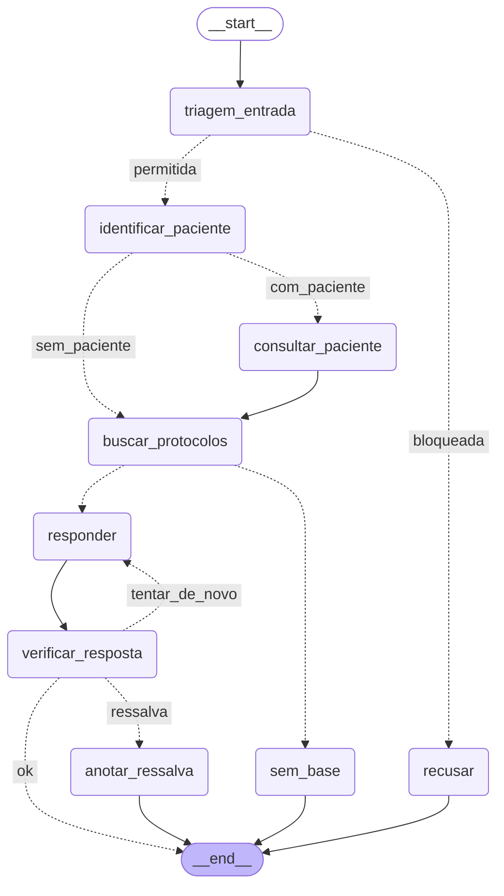
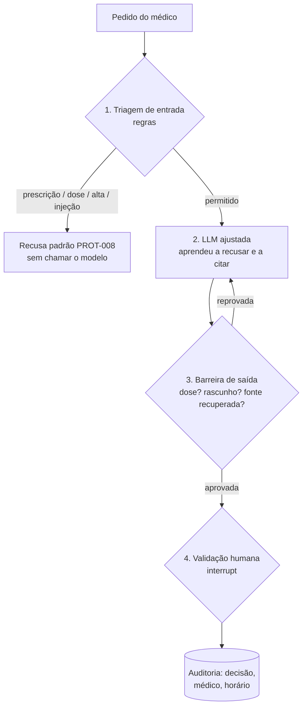
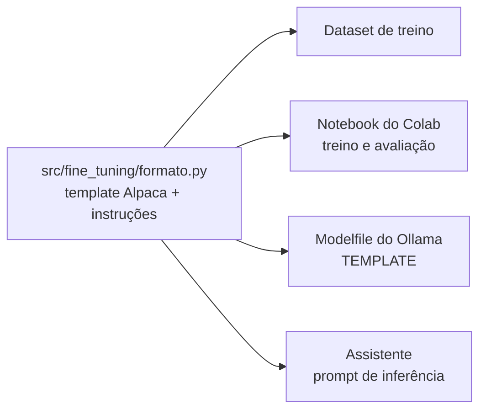
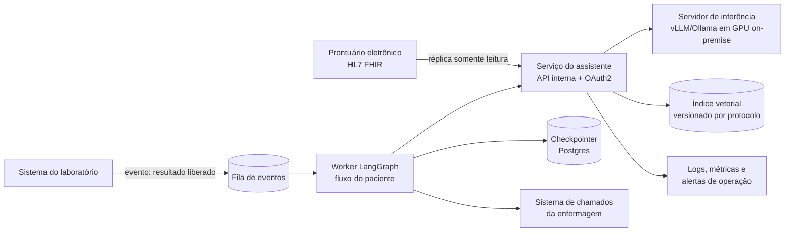

# Arquitetura da Solução

Assistente virtual médico do Hospital Universitário: LLM ajustada por fine-tuning, integrada com
LangChain ao prontuário e aos protocolos internos, e orquestrada com LangGraph.

Os diagramas dos dois fluxos LangGraph (seções 3 e 4) são **gerados do próprio grafo compilado**
por `python scripts/gerar_diagramas.py` — não são desenhos feitos à mão.

---

## 1. Visão geral

| Camada | Componente | Arquivo |
|---|---|---|
| Dados | documentos internos, gerador, anonimização, curadoria | `data/`, `src/dados/`, `src/seguranca/anonimizacao.py` |
| Modelo | fine-tuning, avaliação, exportação | `notebooks/01_fine_tuning_colab.ipynb`, `src/fine_tuning/formato.py`, `src/avaliacao/metricas.py` |
| Integração LangChain | cadeia com a LLM ajustada, ferramentas do prontuário | `src/assistente/llm.py`, `src/prontuario/ferramentas.py` |
| Conhecimento | busca híbrida com fonte | `src/rag/indice.py` |
| Regras clínicas | pendências e valores críticos | `src/prontuario/regras.py` |
| Orquestração LangGraph | fluxo do paciente, perguntas clínicas | `src/assistente/grafo_paciente.py`, `src/assistente/grafo_pergunta.py` |
| Segurança | limites de atuação, auditoria | `src/seguranca/limites.py`, `src/seguranca/auditoria.py` |

---

## 2. Princípio que organiza tudo: a LLM redige, as regras decidem

| Decisão | Quem toma | Por quê |
|---|---|---|
| Quais exames estão pendentes, quais valores são críticos | **regras determinísticas** (`regras.py`) | alerta não pode depender de geração de texto; prova-se com teste |
| Que dado do prontuário consultar | **o grafo** (ferramentas chamadas pelo código) | o modelo nunca escreve SQL nem escolhe o que consultar |
| Quais trechos de protocolo entram no contexto | **busca híbrida + regras** | a mesma função define o contexto no treino e na inferência |
| Como redigir a resposta e a sugestão | **LLM ajustada** | é o que o fine-tuning ensinou: formato da casa, citação, recusa |
| Se a sugestão vale | **médico** (interrupt do LangGraph) | nenhuma conduta é registrada sem decisão humana identificada |

---

## 3. Fluxo automatizado do paciente (LangGraph)

Ao receber um paciente: verificar exames pendentes → emitir alertas → sugerir conduta → validação humana.

<!-- grafo:paciente -->

<!-- /grafo:paciente -->

- **Alertas antes da sugestão.** Valor crítico tem prazo de 30 minutos (PROT-007 §3); não pode esperar o médico ler a sugestão.
- **Ciclo de correção.** Se a barreira de saída reprova a sugestão (dose, sem marca de rascunho, fonte inventada ou alerta crítico omitido), o grafo volta a `sugerir_tratamento` uma vez; na segunda reprovação usa a sugestão das regras (`sugestao_por_regras`), marcada como fallback.
- **Pausa real.** `validacao_humana` usa `interrupt()` com checkpointer: o estado fica salvo e o fluxo só continua com `Command(resume={"decisao": ..., "medico": ...})`.
- **Retry com backoff** no nó que chama o modelo (`RetryPolicy`, 3 tentativas).

## 4. Perguntas clínicas contextualizadas (LangGraph + LangChain)

<!-- grafo:pergunta -->

<!-- /grafo:pergunta -->

- **Triagem antes do modelo.** Pedido de prescrição, dose, alta ou tentativa de *prompt injection* é recusado por regra, sem chamar a LLM.
- **Prontuário atualizado.** Se a pergunta cita um paciente (`P-0000`), as ferramentas leem o banco no momento da pergunta.
- **Sem base, sem resposta.** Se a melhor seção recuperada tem confiança abaixo de 0,25, o modelo não é acionado.
- **Fonte verificada.** Toda fonte citada na resposta precisa estar entre as recuperadas; senão, nova tentativa e, persistindo, a resposta sai com ressalva explícita.

---

## 5. Defesa em camadas (limites de atuação)

---

## 6. Do treino à inferência: o mesmo formato

O template Alpaca (Aula 2 de Fine-Tuning) é definido uma vez e usado nos quatro lugares. Se o formato
da inferência diferisse do treino, o modelo ajustado se comportaria como se não tivesse sido treinado.

---

## 7. Como isso rodaria em produção

Detalhamento (implantação, monitoramento, versionamento, rollback e escalabilidade) no relatório técnico, seção *Implementação em Produção / MLOps*.
