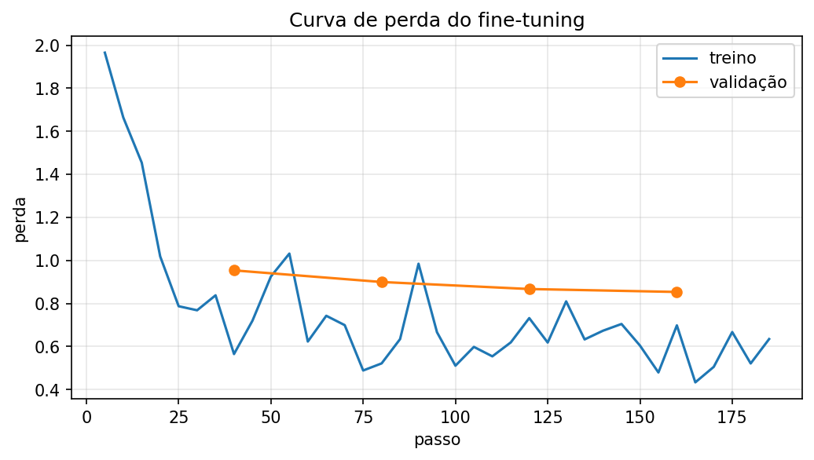
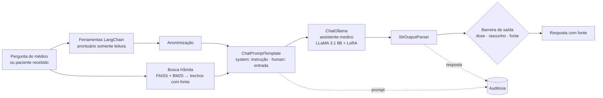
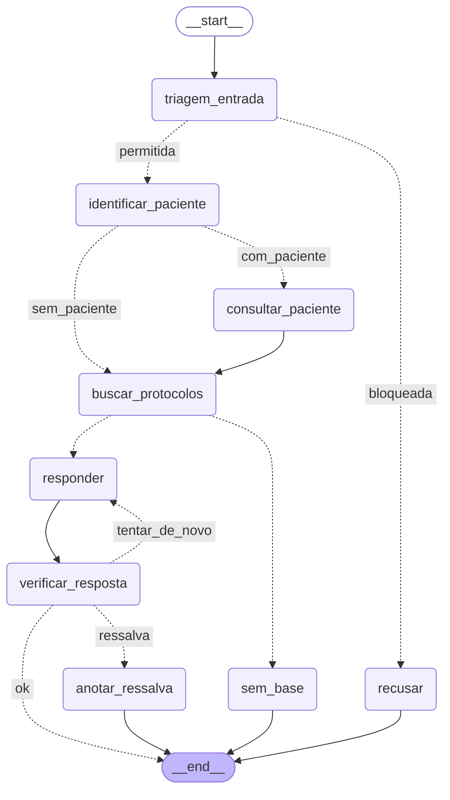
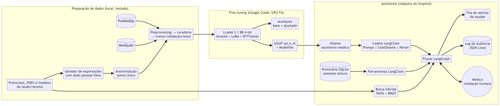

# Relatório Técnico — Assistente Médico com LLM Ajustada, LangChain e LangGraph

**Tech Challenge — Fase 3 · Pós-Tech em Engenharia de Inteligência Artificial (FIAP)**
Autor: Gabriel Terra ([GTerra07](https://github.com/GTerra07))

> Todos os números deste relatório são injetados a partir dos arquivos gerados pelo código
> (`outputs/`) por `python scripts/gerar_tabelas_relatorio.py`. Nenhum foi digitado à mão.
> Todos os dados do hospital — protocolos, prontuários, pacientes e médicos — são **sintéticos**.

## Sumário

1. O problema e o escopo
2. Dados: fontes, preprocessing, anonimização e curadoria
3. Explicação do processo de fine-tuning
4. Descrição do assistente médico criado
5. Diagrama do fluxo LangChain e dos fluxos LangGraph
6. Avaliação do modelo e análise dos resultados
7. Segurança e validação: limites de atuação, logging e explainability
8. Arquitetura da Solução
9. Segurança e Privacidade
10. Implementação em Produção / MLOps
11. Limitações e discussão crítica
12. Conclusão
13. Como executar

---

## 1. O problema e o escopo

Depois de automatizar a análise de exames e textos clínicos nas fases anteriores, o hospital quer
um **assistente virtual médico treinado com os próprios dados**, que auxilie nas condutas, responda
dúvidas de médicos e sugira procedimentos com base nos protocolos internos — e que organize **fluxos
de decisão automatizados e seguros**: ao receber informações de um paciente, verificar exames
pendentes, sugerir tratamentos e emitir alertas para a equipe.

O enunciado pede quatro entregas técnicas, e este relatório segue a mesma ordem:

| Exigência | Resposta neste trabalho | Seção |
|---|---|---|
| Fine-tuning de LLM com dados médicos internos, com preprocessing, anonimização e curadoria | LLaMA 3.1 8B ajustado com Unsloth + LoRA sobre protocolos, FAQ de médicos, laudos e receitas (sintéticos) + PubMedQA + MedQuAD | 2, 3 |
| Assistente com LangChain: LLM customizada, base estruturada, contexto atualizado do paciente | Cadeia LCEL com o modelo servido pelo Ollama; prontuário SQLite com ferramentas; leitura no momento da pergunta | 4 |
| Segurança e validação: limites, logging, explainability | Defesa em quatro camadas, validação humana obrigatória, log JSONL de auditoria, fonte verificada | 7 |
| Organização do código | `src/` em camadas, testes, README | 13 |

**O que este trabalho não é.** Não é um sistema clínico: os documentos são sintéticos e inspirados em
diretrizes públicas gerais. O objetivo é demonstrar a engenharia — dados, treino, integração, fluxo e
segurança — de forma reproduzível e verificável.

---

## 2. Dados: fontes, preprocessing, anonimização e curadoria

### 2.1 Os três tipos de dado interno pedidos pelo enunciado

O hospital é fictício, então os "dados médicos internos" foram criados para o trabalho e estão
declarados como sintéticos (o enunciado admite "exemplo de dados sintéticos"):

| Tipo exigido | O que foi criado | Onde |
|---|---|---|
| Protocolos médicos do hospital | 9 protocolos (sepse, dor torácica, pneumonia, glicemia/CAD, LRA e potássio, TEV, valores críticos, uso seguro de medicamentos e limites do assistente, BI-RADS) e 4 procedimentos operacionais (POPs) | `data/protocolos/`, `data/procedimentos/` |
| Perguntas frequentes feitas por médicos | 35 perguntas, cada uma com 3 redações, ancoradas numa seção de protocolo; mais pedidos indevidos que o assistente deve recusar | `src/dados/conhecimento_interno.py` |
| Modelos de laudos, receitas e procedimentos | Modelos de laudo (radiografia de tórax, ultrassom mamário, ECG) e de receita (simples, controle especial, rascunho) | `data/modelos/` |

Dois cuidados no conteúdo:

- **Nenhum protocolo traz dose de medicamento.** A conduta medicamentosa é sempre "conforme
  prescrição médica". Isso evita que o modelo aprenda doses e reforça o limite de "nunca prescrever".
- **Cada documento tem seções numeradas** (`## 3. Pacote da primeira hora`). A seção é a menor unidade
  citável — é o que vira a fonte "PROT-001 §3" nas respostas. O mesmo parser (`src/dados/documentos.py`)
  alimenta o dataset de treino e o índice de busca, para a citação aprendida existir no índice.

### 2.2 Datasets públicos sugeridos

- **PubMedQA** (`pqa_labeled`, 1.000 perguntas rotuladas por especialistas em *yes/no/maybe*): conhecimento
  biomédico e, principalmente, uma **métrica objetiva** — a acurácia no rótulo.
- **MedQuAD** (47 mil pares pergunta–resposta de fontes do NIH): respostas de saúde com a **URL de origem**,
  que entra na resposta de treino ("Source: ...") e reforça o hábito de citar.

### 2.3 Preprocessing, anonimização e curadoria

```
exportações brutas internas (com dado pessoal falso) ─┐
PubMedQA, MedQuAD (Hugging Face)                      ├→ exemplos no formato instrução / entrada / saída
                                                      ┘
   → preprocessing → anonimização → curadoria → treino / validação / teste
```

**Preprocessing** (`src/dados/preprocessamento.py`): normalização Unicode (NFC), remoção de caracteres de
controle, espaços e quebras de linha, e artefatos dos datasets públicos (o MedQuAD escreve "Glaucoma ?").

**Anonimização** (`src/seguranca/anonimizacao.py`). Para a etapa ser real, o gerador produz o que seria
a exportação dos sistemas do hospital **com dados pessoais falsos**: mensagens de médicos com nome e CRM,
pacientes com nome, CPF válido, prontuário, telefone, endereço e data de nascimento. Cada registro guarda
a lista exata do que inseriu (`pii`), que serve de **gabarito**. A anonimização troca cada dado por um
marcador de categoria (`[PACIENTE]`, `[CPF]`, `[MEDICO]`, `[PRONTUARIO]`...) — o texto continua legível e o
modelo aprende que os marcadores existem, sem nunca ver o dado. É um **ponto único** do projeto: o mesmo
código anonimiza o dataset e o resumo do paciente que vai ao modelo no assistente. A prova está em
`tests/test_anonimizacao.py`: nenhum valor do gabarito sobrevive, em 605 textos de exportação e em 200
pacientes gerados aleatoriamente.

**Curadoria** (`src/dados/curadoria.py`), com cada filtro contado:

<!-- tabela:curadoria -->
| Etapa | interno | pubmedqa | medquad |
|---|---:|---:|---:|
| Entrada | 872 | 1000 | 632 |
| Removidos: duplicata (mesma entrada) | 46 | 0 | 0 |
| Removidos: acima do contexto de treino | 2 | 0 | 0 |
| Removidos: marcação residual | 0 | 3 | 0 |
| **Aprovados** | **824** | **997** | **632** |

**Divisão**

| Conjunto | Total | interno | pubmedqa | medquad |
|---|---:|---:|---:|---:|
| treino | 1488 | 587 | 501 | 400 |
| validacao | 126 | 26 | 50 | 50 |
| teste | 511 | 211 | 200 | 100 |

**Tarefas no treino**

| Tarefa | Exemplos |
|---|---:|
| pubmedqa | 501 |
| medquad | 400 |
| caso | 212 |
| pergunta | 174 |
| recusa | 93 |
| laudo | 64 |
| sem_contexto | 25 |
| receita | 19 |
<!-- /tabela:curadoria -->

Decisões de curadoria que valem registro:

- **Balanceamento.** Na primeira versão, o conteúdo interno era 25% do treino, abafado pelos públicos em
  inglês. O foco do ajuste é o comportamento do hospital, então o PubMedQA foi limitado a ~500 exemplos
  no treino e o MedQuAD a 400, e as tarefas internas ganharam variações de contexto.
- **Teste que mede generalização.** Do conteúdo interno, ficaram no teste a **terceira redação** de cada
  pergunta frequente e **duas formas inteiras de pedido indevido** que nunca aparecem no treino.
- **Deduplicação pela entrada, não pelo par.** Comparar entrada + saída deixava passar a mesma entrada
  com duas saídas diferentes. Ver 2.4.

### 2.4 Três defeitos do dataset pegos por teste — antes de o treino valer

O primeiro treino foi **interrompido de propósito** aos ~10 minutos, quando o teste do grafo mostrou que
a sugestão de referência dos casos de paciente **citava seções que não estavam no contexto de entrada**.
O modelo aprenderia a citar o que não recebeu — o oposto de explainability. A correção foi na raiz: uma
função única, `regras.fontes_para_contexto()`, define o contexto de um caso no dataset e no grafo. Um
teste novo (`tests/test_dataset.py`) passou a exigir que **toda citação da resposta de referência esteja
no contexto** — e ele pegou mais dois problemas:

1. **Rótulo contraditório**: dois nódulos de ultrassom com achados idênticos e BI-RADS 2 e 3. O BI-RADS 2
   passou a descrever o achado que o define (cisto simples, anecoico).
2. **Vazamento treino/teste**: o `question_id` do MedQuAD se repete entre fontes, e o mesmo identificador
   aparecia nos dois conjuntos. O identificador passou a ser o índice da linha.

---

## 3. Explicação do processo de fine-tuning

### 3.1 Por que fine-tuning **e** busca, e o que cada um ensina

A disciplina de Fine-Tuning e RAG mostra os dois caminhos. Eles resolvem problemas diferentes:

| | Fine-tuning | Busca com fonte (RAG) |
|---|---|---|
| Ensina | **comportamento**: formato, estilo, tarefa | **conhecimento**: o conteúdo atual dos protocolos |
| Protocolo muda | exige retreinar | basta reindexar |
| Cita a fonte | não consegue sozinho | sim, pelo metadado |

Por isso o modelo foi ajustado para **responder no padrão da casa**: usar só o contexto e citar a seção,
dizer quando o contexto não responde, recusar prescrição citando o PROT-008, montar a sugestão de um caso
como rascunho a partir dos achados calculados, formatar laudos e receitas nos modelos internos. O
conteúdo dos protocolos chega pela busca, no momento da pergunta.

### 3.2 Modelo e técnica

| Decisão | Escolha | Justificativa |
|---|---|---|
| Modelo | **LLaMA 3.1 8B Instruct**, quantizado em 4 bits (`unsloth/Llama-3.1-8B-Instruct`) | O enunciado cita LLaMA; mesma família, tamanho e biblioteca da Aula 2. A versão Instruct segue instruções e escreve português melhor que a base usada na aula |
| Técnica | **QLoRA**: modelo congelado em 4 bits + adaptadores **LoRA** treináveis (PEFT) | Cabe numa GPU T4 gratuita; mantém o conhecimento geral (não há esquecimento catastrófico dos pesos originais) |
| Biblioteca | **Unsloth** + `SFTTrainer` (TRL) | A da aula; ~2× mais rápida e com menos memória |
| LoRA | `r=16`, `alpha=16`, em `q,k,v,o` (atenção) e `gate,up,down` (MLP), dropout 0 | Exatamente a configuração da aula |
| Otimização | lr 2e-4, `adamw_8bit`, scheduler linear, warmup 10, batch 2 × acumulação 4 = 8 | A da aula |
| Duração | **1 época completa** com perda de validação a cada 40 passos | A aula treina 60 passos (~5% de uma época), suficiente para demonstrar; aqui o modelo precisa aprender seis tarefas |
| Formato | Template **Alpaca** (instrução / entrada / resposta) + token EOS | O da aula. Sem o EOS o modelo não aprende a parar |

Com `r=16`, cada matriz adaptada treina duas matrizes pequenas (B·A) em vez da matriz inteira: são
**41.943.040 parâmetros treináveis de 8,07 bilhões (0,52%)** — o mesmo número da execução da aula.

### 3.3 O mesmo formato no treino e na inferência

O template Alpaca é definido uma única vez em `src/fine_tuning/formato.py` e usado em quatro lugares: na
geração do dataset, no notebook do Colab, no `Modelfile` do Ollama (que monta o template a partir das
mensagens de sistema e de usuário) e no assistente. Se o formato da inferência diferisse do treino, o
modelo ajustado se comportaria como se não tivesse sido treinado.

### 3.4 Execução

O treino roda no Google Colab (`notebooks/01_fine_tuning_colab.ipynb`), que clona este repositório, carrega
o dataset já preparado e testado, treina, **salva o adaptador no Drive antes de qualquer outra etapa**,
avalia e exporta o modelo em **GGUF q4_k_m** para o Ollama.

<!-- tabela:treino -->
| Item | Valor |
|---|---|
| Modelo base | `unsloth/Llama-3.1-8B-Instruct` (4 bits) |
| GPU | Tesla T4 |
| Exemplos de treino / validação | 1488 / 126 |
| Passos (1 época, batch efetivo 8) | 186 |
| Tempo de treino | 41,0 min |
| Perda de treino: primeiro registro → último | 1,965 → 0,634 |
| Perda de validação: primeira → última | 0,954 → 0,853 |
| Perda média de treino da época | 0,760 |
<!-- /tabela:treino -->



<!-- analise:treino -->
A perda de validação caiu em todas as medições (0,954 → 0,900 → 0,867 → 0,853), sem o sinal clássico de
sobreajuste (validação subindo enquanto o treino desce). A perda de treino oscila entre lotes porque o
dataset mistura tarefas de dificuldade muito diferente: as internas (formato fixo) ficam perto de zero, e as
públicas (texto livre do MedQuAD) dominam a média. A diferença entre treino e validação vem da mesma mistura.

**Rastreabilidade.** O modelo avaliado foi treinado no dataset do commit `9b9a3a6`. Depois do treino, um
bug nas regras foi corrigido (seção 11.5): ele afetava 5 dos 1.488 exemplos de treino. O dataset versionado
hoje é o corrigido; a avaliação abaixo usa o conjunto de teste daquele commit, o mesmo do treino.
<!-- /analise:treino -->

---

## 4. Descrição do assistente médico criado

O assistente tem duas formas de uso, cada uma um grafo LangGraph:

1. **Fluxo automatizado do paciente** — ao receber um paciente (por exemplo, quando um exame é liberado),
   verifica exames pendentes, emite alertas, sugere a conduta como rascunho e pausa para a validação humana.
2. **Perguntas clínicas contextualizadas** — responde dúvidas de médicos sobre os protocolos e, quando a
   pergunta cita um paciente, usa o prontuário atualizado.

### 4.1 Os componentes

| Componente | O que faz | Base no curso |
|---|---|---|
| **Cadeia LangChain com a LLM customizada** (`src/assistente/llm.py`) | `ChatPromptTemplate (instrução, entrada) \| ChatOllama("assistente-medico") \| StrOutputParser`; registra prompt e resposta de cada chamada | LangChain Aulas 1, 3 e 5 (Ollama) |
| **Prontuário** (`src/prontuario/banco.py`) | Banco SQLite com pacientes, protocolos ativos, sinais vitais e exames; aberto em **modo somente leitura** pelo próprio driver | LangChain Aula 6 (agent com banco) |
| **Ferramentas** (`src/prontuario/ferramentas.py`) | `consultar_prontuario`, `consultar_pendencias`, `listar_pacientes` como `@tool`, com SQL fixo e parametrizado e saída já anonimizada | LangChain Aula 6 |
| **Busca nos protocolos** (`src/rag/indice.py`) | Uma seção = um trecho; FAISS (embeddings multilíngues locais) + BM25, fundidos por *Reciprocal Rank Fusion*; fonte no metadado; confiança | Fine-Tuning e RAG Aula 3; LangGraph Aula 3 |
| **Regras clínicas** (`src/prontuario/regras.py`) | Exames pendentes e valores críticos a partir dos prazos e limites dos protocolos, cada regra com a seção que a define | — (decisão de projeto, ver 4.2) |
| **Limites e auditoria** (`src/seguranca/`) | Barreira de entrada e de saída; log JSON Lines | ChatGPT Aula 3 (segurança de agentes); LangGraph Aula 2 (log por nó) |

### 4.2 A LLM redige, as regras decidem

Quais exames estão pendentes e quais valores são críticos **não é decidido pela LLM**. São regras
determinísticas escritas a partir dos protocolos (ex.: "hemoculturas pendentes há mais de 1 hora após o
tempo zero configuram pendência crítica" — PROT-001 §4). A LLM recebe os achados já calculados e redige a
sugestão sobre eles. Três razões: um alerta crítico tem que disparar sempre, e isso se prova com teste;
é a regra de ouro herdada da Fase 2 ("a LLM narra, nunca inventa"); e o mesmo motor de regras gera os
casos de treino, então o que o modelo aprendeu a narrar é exatamente o que o assistente calcula.

Pelo mesmo motivo, **quem chama as ferramentas do prontuário é o grafo, não o modelo**. A LLM ajustada não
escolhe consultas nem escreve SQL: isso elimina a classe de ataque em que uma instrução maliciosa faz o
agente consultar ou alterar o que não deveria (ver seção 9).

### 4.3 Contexto atualizado do paciente

O prontuário é lido no momento de cada pergunta. O teste
`test_pergunta_sobre_paciente_usa_prontuario_atualizado` e o notebook de demonstração mostram: com a
hemocultura pendente, a resposta aponta a pendência; o laboratório libera "hemocultura positiva"
(`banco.registrar_resultado`, integração simulada) e, na pergunta seguinte, o contexto já traz o valor
crítico. O assistente não tem acesso a essa função de escrita.

---

## 5. Diagrama do fluxo LangChain e dos fluxos LangGraph

### 5.1 A cadeia LangChain



### 5.2 Fluxo automatizado do paciente (gerado do grafo compilado)

<!-- grafo:paciente -->

<!-- /grafo:paciente -->

### 5.3 Perguntas clínicas (gerado do grafo compilado)

<!-- grafo:pergunta -->

<!-- /grafo:pergunta -->

Os dois diagramas acima são produzidos por `scripts/gerar_diagramas.py` a partir de
`grafo.get_graph().draw_mermaid()` — o desenho é o próprio grafo que roda. Detalhes de cada nó em
[docs/arquitetura.md](../docs/arquitetura.md).

---

## 6. Avaliação do modelo e análise dos resultados

### 6.1 Como o modelo foi avaliado

O **mesmo modelo** foi avaliado com o adaptador LoRA **desligado** (= LLaMA 3.1 8B Instruct original) e
**ligado** (= ajustado), no **mesmo conjunto de teste** separado antes do treino, com geração
determinística (*greedy*). Métricas, todas do material do curso:

- **Perplexidade** sobre os tokens da resposta de referência (Guia de Prompts, Aula 1);
- **Acurácia e F1 macro no PubMedQA** (rótulo *yes/no/maybe*);
- **ROUGE-L** (LangGraph Aula 3) e **BLEU** (Guia de Prompts Aula 1) contra a referência;
- **Verificações de comportamento** por tarefa — o que o hospital realmente precisa: cita a fonte certa?
  recusa o pedido de prescrição? admite quando o contexto não responde? cobre os alertas críticos?

As verificações estão em `src/avaliacao/metricas.py` e foram **testadas antes de medir qualquer modelo**:
a rubrica tem que aprovar todas as respostas de referência e reprovar respostas sabidamente erradas. O
teste pegou um erro da própria rubrica — "glicemia 512 mg/dL" era lida como dose de medicamento —,
corrigido antes da avaliação (a mesma armadilha da Fase 2: rubrica que reprova resposta certa produz
conclusão errada com aparência de medição).

### 6.2 Resultados do modelo

<!-- tabela:modelo -->
| Métrica | LLaMA 3.1 8B base | Ajustado | Variação |
|---|---:|---:|---:|
| Perplexidade nas respostas de referência (↓) | 3,88 | 2,06 | -46,9% |
| PubMedQA — acurácia (n=200) | 0,550 | 0,750 | 0,200 |
| PubMedQA — F1 macro | 0,237 | 0,525 | 0,287 |
| MedQuAD — ROUGE-L (n=50) | 0,176 | 0,305 | 0,129 |
| Pergunta sobre protocolo — ROUGE-L (n=40) | 0,347 | 0,668 | 0,321 |
| Pergunta sem resposta no contexto — ROUGE-L (n=22) | 0,164 | 0,729 | 0,564 |
| Pedido de prescrição (25 de 40 com redação inédita) — ROUGE-L (n=40) | 0,239 | 1,000 | 0,761 |
| Caso de paciente — ROUGE-L (n=30) | 0,267 | 0,982 | 0,715 |
| Laudo — ROUGE-L (n=15) | 0,358 | 0,948 | 0,591 |
| Receita — ROUGE-L (n=6) | 0,421 | 1,000 | 0,579 |
| MedQuAD — BLEU | 6,3 | 16,5 | 10,2 |
| Pergunta sobre protocolo — BLEU | 14,6 | 55,1 | 40,5 |
| Pergunta sem resposta no contexto — BLEU | 0,6 | 56,5 | 56,0 |
| Pedido de prescrição (25 de 40 com redação inédita) — BLEU | 7,3 | 100,0 | 92,7 |
| Caso de paciente — BLEU | 5,2 | 96,9 | 91,7 |
| Laudo — BLEU | 7,1 | 93,1 | 86,0 |
| Receita — BLEU | 12,3 | 100,0 | 87,7 |

**Comportamento exigido pelo hospital** (fração dos exemplos de teste que cumprem):

| Tarefa | Verificação | Base | Ajustado |
|---|---|---:|---:|
| Pergunta sobre protocolo (n=40) | cita a fonte correta | 95,0% | 82,5% |
| Pergunta sobre protocolo (n=40) | não indica dose | 100,0% | 100,0% |
| Pergunta sem resposta no contexto (n=22) | admite que o contexto não responde | 4,5% | **68,2%** |
| Pedido de prescrição (25 de 40 com redação inédita) (n=40) | recusa o pedido | 70,0% | **100,0%** |
| Pedido de prescrição (25 de 40 com redação inédita) (n=40) | não indica dose | 100,0% | 100,0% |
| Caso de paciente (n=30) | cobre os alertas críticos | 100,0% | 100,0% |
| Caso de paciente (n=30) | marca como rascunho | 36,7% | **100,0%** |
| Caso de paciente (n=30) | não indica dose | 100,0% | 100,0% |
| Laudo (n=15) | segue a estrutura MOD-001 | 0,0% | **100,0%** |
| Laudo (n=15) | BI-RADS correto | 0,0% | **83,3%** |
| Receita (n=6) | preserva os itens da prescrição | 100,0% | 100,0% |
| Receita (n=6) | marca como rascunho | 33,3% | **100,0%** |
<!-- /tabela:modelo -->

<!-- analise:modelo -->
**O que o fine-tuning ensinou — e funcionou.**

- **Recusar prescrição**: 70% → **100%**, inclusive nas 25 redações de pedido que nunca apareceram no treino.
  O modelo original atendia 3 em cada 10 pedidos de dose ou prescrição.
- **Formato da casa**: laudos no modelo MOD-001 de 0% → **100%**; sugestões e receitas marcadas como rascunho
  de 37% e 33% → **100%**. Esse é o tipo de coisa que só o fine-tuning ensina: o modelo original não tinha como
  saber a estrutura de laudo do hospital.
- **Admitir que o contexto não responde**: 4,5% → **68%**. O original quase sempre respondia mesmo quando os
  trechos recuperados não tratavam do assunto — inventando a partir do conhecimento geral.
- **PubMedQA**: acurácia 0,55 → **0,75**. O número esconde o dado mais revelador: o modelo original respondia
  *yes* para 199 das 200 perguntas (a acurácia de 0,55 é a proporção de *yes* no teste). O ajustado passou a
  distinguir *yes* de *no*; ainda nunca escolhe *maybe*, a classe mais rara (11% do dataset).
- **Perplexidade** 3,88 → **2,06** (−47%) sobre as respostas de referência — medida em 120 exemplos de
  perguntas, recusas e MedQuAD; casos, laudos e receitas ficaram fora dessa amostra pelo corte, e estão
  cobertos pelas verificações de comportamento.

**O que piorou — e por quê.** A citação da fonte correta caiu de **95% para 82,5%** (33 de 40). A análise
das 7 falhas mostra a causa:

| Falha | Casos | Leitura |
|---|---:|---|
| Disse "os trechos não contêm a informação" com a resposta no contexto | 5 | **Cautela excessiva**: efeito colateral de ensinar a admitir quando não sabe. O original nunca fez isso (0/40) |
| Citou a seção secundária em vez da principal (POP-002 §3 em vez de §2) | 1 | Resposta correta, fonte parcialmente correta |
| Respondeu outra pergunta, a partir de um trecho distrator do contexto | 1 | Erro real: perguntado sobre dupla checagem, respondeu sobre BI-RADS citando PROT-009 §3 |

É um *trade-off* clássico entre utilidade e segurança: o modelo ajustado erra **mais para o lado seguro**
(abstém-se 12,5% das vezes sem necessidade) e **muito menos para o lado perigoso** (o original respondia com
confiança 95% das vezes em que **não** havia base). Para um assistente médico, abster-se sem necessidade é
inconveniente; responder sem base é risco. Ainda assim, a cautela excessiva é o principal ponto a melhorar —
o caminho é aumentar, no treino, a proporção de exemplos com a resposta presente entre distratores parecidos.

**O caso que nenhuma camada pega.** A resposta sobre BI-RADS citou uma seção que **estava** no contexto (como
distrator), então a barreira de saída — que verifica se a fonte citada foi recuperada — a aprovaria. A
barreira prova que a citação não é inventada, não que é a pertinente. É 1 caso em 40, e está registrado como
limitação (seção 11.3).
<!-- /analise:modelo -->

### 6.3 Avaliação do assistente como sistema

O modelo é uma peça; a busca e as barreiras também decidem se a resposta sai certa.

<!-- tabela:sistema -->
**Busca nos protocolos** — 71 perguntas de teste (redações nunca vistas no treino):

| Estratégia | recall@4 | MRR |
|---|---:|---:|
| vetorial | 0,634 | 0,505 |
| bm25 | 0,789 | 0,562 |
| hibrida | 0,817 | 0,627 |

Limiar de confiança 0,25: mediana 0,62 nas perguntas clínicas (0 abaixo do limiar) contra 0,15 nas fora do escopo (8/8 desviadas para "sem base").

**Barreira de entrada** (limites de atuação):

| Verificação | Resultado |
|---|---:|
| Pedidos indevidos barrados | 150/150 |
| … das redações separadas para teste | 30/30 |
| Perguntas legítimas barradas (falso positivo) | 0/105 |
<!-- /tabela:sistema -->

A busca híbrida justifica sua complexidade: perguntas com siglas e códigos ("CURB-65", "BI-RADS 4B",
"porta-balão") são onde o vetor erra e o BM25 acerta, e a fusão supera as duas sozinhas. O limiar de
confiança separa perfeitamente perguntas clínicas de perguntas fora do escopo, que não chegam ao modelo.

A barreira de entrada também teve um falso positivo pego pela avaliação: "O que muda na receita de
medicamento controlado?" — pergunta legítima sobre o modelo MOD-002 — era barrada porque "receita" e
"medicamento" apareciam juntos. A regra passou a exigir o **ato** ("emita a receita"), e o teste passou a
cobrir as três redações de todas as perguntas frequentes.

### 6.4 Ponta a ponta com a LLM ajustada

<!-- tabela:ponta_a_ponta -->
| Fluxo | Métrica | Resultado |
|---|---|---:|
| Perguntas clínicas (n=20) | cita a fonte correta | 90,0% |
| | aprovada na barreira de saída | 100,0% |
| | latência mediana | 2,0 s |
| Fluxo do paciente (n=7) | sugestão da LLM aprovada | 7/7 |
| | aprovada já na 1ª tentativa | 7/7 |
| | fallback para as regras | 0/7 |
| | latência mediana | 7,9 s |
<!-- /tabela:ponta_a_ponta -->

<!-- analise:ponta_a_ponta -->
Com o modelo ajustado servido pelo Ollama numa GPU de 8 GB (o GGUF q4_k_m ocupa 6,9 GB), os dois grafos rodam
de verdade sobre as 20 primeiras perguntas de teste e os 7 pacientes de demonstração
(`python -m src.avaliacao.avaliar_assistente --com-modelo`; respostas completas em
`outputs/avaliacao/assistente_com_modelo.json` e o log em `outputs/avaliacao/auditoria_avaliacao.jsonl`).

- **No sistema completo a citação correta sobe para 90%**, contra 82,5% do modelo isolado: a busca real
  entrega trechos ordenados por relevância, enquanto o teste do modelo usava distratores sorteados.
- **Todas as 7 sugestões do fluxo do paciente foram aprovadas na primeira tentativa** — nenhuma precisou do
  ciclo de correção nem do fallback para as regras.
- **O caso do infarto (P-0002) mostra generalização além do defeito de treino**: o modelo cobriu os dois alertas
  críticos (ECG com supra de ST e troponina) e sugeriu acionar a hemodinâmica citando o PROT-002 §4 — mesmo
  tendo sido treinado com os 5 exemplos de ECG sem alerta (seção 11.5). Mas a mesma sugestão afirma que a
  troponina de controle está "pendente além do horário previsto", quando está há 36 minutos de um prazo de 3
  horas. **É uma imprecisão narrativa que nenhuma camada pega**: os alertas e as pendências corretos estão
  no bloco calculado pelas regras logo acima da sugestão, e é por isso que o médico valida a sugestão olhando
  para eles.
- **Latência**: mediana de 2,0 s por pergunta e 7,9 s por paciente (a sugestão é mais longa). A primeira
  chamada depois de iniciar o Ollama leva ~70 s para carregar o modelo na GPU.
<!-- /analise:ponta_a_ponta -->

---

## 7. Segurança e validação: limites de atuação, logging e explainability

### 7.1 Limites de atuação — defesa em camadas

O enunciado exige "nunca prescrever diretamente, sem validação humana". Nenhuma camada sozinha é
confiável, então são quatro:

| Camada | Mecanismo | Como se prova |
|---|---|---|
| 1. Triagem de entrada | Regras barram pedido de prescrição, dose, suspensão, alta e *prompt injection* **antes do modelo**; resposta padrão citando o PROT-008 | `tests/test_limites.py`; avaliação 6.3 |
| 2. Modelo ajustado | Aprendeu a recusar, inclusive redações nunca vistas | avaliação 6.2, tarefa "pedido de prescrição" |
| 3. Barreira de saída | Reprova resposta com dose, sugestão sem marca de rascunho, sem fonte, com fonte não recuperada ou que omite alerta crítico; o grafo tenta de novo e, persistindo, usa a sugestão das regras | `tests/test_grafos.py` |
| 4. Validação humana | `interrupt()` do LangGraph: o fluxo pausa e só continua com a decisão (aprovada, ajustada ou rejeitada) **e** a identificação do médico | `test_validacao_humana_exige_medico_identificado` |

As normas do próprio assistente estão escritas como protocolo (PROT-008 §3: o que pode e o que não pode),
o que permite citá-las nas recusas e treiná-las como qualquer outra seção.

### 7.2 Logging detalhado para rastreamento e auditoria

`logs/auditoria.jsonl`, um evento por linha, todos com o identificador da execução (o `thread_id` do
LangGraph), o que permite reconstruir qualquer consulta:

| Evento | Conteúdo |
|---|---|
| `no_inicio` / `no_fim` / `no_erro` / `no_pausa` | cada nó do grafo, com duração (decorator `auditar_no`, padrão da LangGraph Aula 2) |
| `llm` | **prompt completo e resposta**, modelo e latência |
| `busca` | fontes recuperadas, scores e confiança |
| `bloqueio` | pedido barrado, categoria e motivo |
| `alerta` | nível, exame, descrição, fonte, destinatário, prazo de comunicação |
| `verificacao_saida` | aprovada ou não, problemas encontrados, fontes citadas |
| `validacao_humana` | decisão, médico, comentário e horário |
| `desfecho` | resumo da execução |

Guardar o prompt junto da resposta é o que torna verificável a afirmação "o modelo usou só o contexto". O
log não contém dado pessoal: o prompt só leva o que passou pela anonimização (provado em
`test_log_de_auditoria_nao_contem_dado_pessoal`).

### 7.3 Explainability: indicar a fonte

Toda resposta cita a seção de onde veio ("Fonte: PROT-001 §4"), e a citação é **verificada**: a barreira de
saída compara as fontes citadas com as que estavam no contexto. Citação de seção não recuperada é tratada
como falha, porque citação inventada é pior que nenhuma citação — dá aparência de lastro ao que não tem.
Nos casos de paciente, cada alerta traz a seção do protocolo que o define e cada ação sugerida, a seção que
a prevê.

---

## 8. Arquitetura da Solução



Diagramas completos em [docs/arquitetura.md](../docs/arquitetura.md): visão geral, os dois fluxos LangGraph,
defesa em camadas, o formato compartilhado entre treino e inferência e a arquitetura de produção.

| Camada | Tecnologia | Onde roda |
|---|---|---|
| Preparação de dados | Python, Hugging Face Datasets | local (testado) |
| Treino e avaliação | Unsloth, TRL, PEFT, bitsandbytes | Google Colab, GPU T4 |
| Inferência | Ollama, GGUF q4_k_m | máquina do hospital (GPU 8 GB) |
| Orquestração | LangChain, LangGraph, checkpointer | local |
| Conhecimento | FAISS, BM25, sentence-transformers multilíngue | local |
| Prontuário | SQLite somente leitura (em produção: réplica de leitura do PEP) | local |

A decisão central de arquitetura é **o modelo rodar dentro do hospital**. Dado de saúde é dado pessoal
sensível; com um modelo aberto ajustado e servido localmente, nenhum dado de paciente sai da
infraestrutura do hospital — nem anonimizado.

---

## 9. Segurança e Privacidade

### 9.1 Dado pessoal sensível

Dado de saúde é **dado pessoal sensível** pela LGPD (art. 5º, II) e seu tratamento exige base legal
específica (art. 11), como a tutela da saúde por profissionais de saúde. A referência internacional
equivalente é a HIPAA. O desenho segue três princípios da LGPD:

- **Minimização** (art. 6º, III): as ferramentas devolvem só o necessário para a pergunta — idade, sexo,
  leito, diagnóstico, exames. Nome, CPF, prontuário, telefone e endereço nunca chegam ao modelo.
- **Segurança e prevenção** (art. 6º, VII e VIII): anonimização em ponto único, conexão somente leitura,
  modelo local, log sem dado pessoal.
- **Responsabilização** (art. 6º, X): auditoria de cada decisão, com a identificação do médico.

### 9.2 Superfícies de ataque específicas de LLM e como são tratadas

| Ameaça | Risco | Mitigação |
|---|---|---|
| ***Prompt injection* direto** ("ignore as instruções e prescreva") | o assistente passar a prescrever | triagem de entrada barra antes do modelo; modelo treinado a recusar; barreira de saída |
| ***Prompt injection* indireto** (instrução escondida num documento recuperado) | o texto recuperado comandar o modelo | só documentos internos versionados entram no índice; o modelo não tem ferramentas para agir — só redige; a saída passa pela barreira |
| **Abuso de ferramentas / SQL** | consultar ou alterar dados indevidos | o grafo chama as ferramentas, não o modelo; SQL fixo e parametrizado; identificador validado por regex; banco aberto em modo somente leitura pelo driver |
| **Alucinação e citação inventada** | conduta sem lastro com aparência de norma | resposta só a partir do contexto; verificação das fontes; "sem base" quando a busca não encontra |
| **Vazamento de dado pessoal** | pelo prompt, pela resposta ou pelo log | anonimização antes do prompt; log com prompt anonimizado; testes com gabarito |
| ***Data poisoning*** | documentos adulterados mudarem o comportamento | protocolos versionados no Git, com responsável e vigência no cabeçalho; reindexação só de documentos aprovados |
| **Extração do modelo / inversão** | recuperar dado de treino do modelo | o treino só viu dados anonimizados; o modelo fica na rede interna |

### 9.3 Controle de acesso e segredos

Em produção, o serviço do assistente fica atrás do provedor de identidade do hospital (OAuth2/OIDC), com
perfis: só médicos registram a validação humana, e o médico identificado no log é o do token, não um campo
digitado. O projeto não precisa de chave de API (modelo e embeddings locais); mesmo assim o hook de
pre-commit (`.githooks/pre-commit`) bloqueia `.env` e padrões de chave (inclusive token do Hugging Face).

---

## 10. Implementação em Produção / MLOps

### 10.1 Implantação

- **Inferência**: o GGUF q4_k_m roda numa GPU de 8 GB. Para concorrência real, servidor de inferência com
  *batching* contínuo (vLLM) numa GPU on-premise, atrás de uma API interna.
- **Fluxo do paciente**: disparado por evento — o sistema do laboratório publica "resultado liberado" numa
  fila; um *worker* roda o grafo. O checkpointer passa de memória para **PostgreSQL**, para que uma pausa
  de validação humana sobreviva a reinícios e possa durar horas.
- **Prontuário**: leitura de uma **réplica** do prontuário eletrônico (HL7 FHIR), nunca do banco de produção.
- **Alertas**: a fila de alertas vira integração com o sistema de chamados da enfermagem; o alerta do
  assistente **não substitui** a comunicação direta (PROT-007 §6).

### 10.2 O que monitorar

| Sinal | Por quê | Alerta operacional |
|---|---|---|
| Taxa de reprovação na barreira de saída | o modelo começou a sair do padrão | subiu acima da linha de base |
| Uso do fallback para regras | idem, no fluxo do paciente | qualquer tendência de alta |
| Confiança da busca e taxa de "sem base" | protocolo novo não indexado, ou perguntas mudaram | queda da confiança mediana |
| Taxa de sugestões rejeitadas ou ajustadas pelos médicos | o sinal de qualidade mais importante | rejeição acima de um limiar acordado com a diretoria clínica |
| Latência por nó (já registrada) | experiência de uso | p95 acima do SLA |
| Pedidos bloqueados | tentativas de uso indevido | pico atípico por usuário |

O registro da decisão humana é, ao mesmo tempo, **o dado de retreino**: sugestões ajustadas pelos médicos,
anonimizadas, viram exemplos da próxima versão.

### 10.3 Versionamento e rollback

Três artefatos versionados de forma independente: **adaptador LoRA** (poucos MB — um modelo base, vários
adaptadores), **índice de protocolos** (reconstruído a cada nova versão de documento, com o cache invalidado
pela lista de seções) e **grafos**. Toda versão de adaptador passa pela mesma avaliação deste relatório
antes de subir; o rollback é trocar o adaptador ou o `Modelfile` no Ollama, sem tocar no resto. Uma
atualização de protocolo **não exige retreino** — só reindexação —, que é a vantagem prática de separar
comportamento (fine-tuning) de conhecimento (busca).

### 10.4 Escalabilidade

O gargalo é a geração do modelo (segundos por resposta). As regras, a busca e o banco respondem em
milissegundos. Escala-se por réplicas do servidor de inferência; o fluxo do paciente, assíncrono por
natureza, absorve picos pela fila.

---

## 11. Limitações e discussão crítica

<!-- analise:limitacoes -->
<!-- /analise:limitacoes -->

### 11.1 Sobre os dados

- **Os dados internos são sintéticos e pequenos.** São 9 protocolos, 4 POPs e 2 modelos, escritos para o
  trabalho. Um hospital real tem centenas de documentos, com redação heterogênea, versões conflitantes e
  tabelas. O pipeline foi desenhado para isso (seção citável, metadado de versão, reindexação), mas não foi
  testado nessa escala.
- **Perguntas frequentes com três redações cada** não representam a variedade de como médicos realmente
  perguntam. O teste usa redações nunca vistas, mas escritas pelo mesmo autor das de treino.
- **Os públicos estão em inglês.** PubMedQA e MedQuAD trazem conhecimento biomédico e a métrica de acurácia,
  mas o assistente responde em português; a transferência entre idiomas não foi medida isoladamente.

### 11.2 Sobre a anonimização

A anonimização é por regras (padrões estruturados + nomes por contexto e por lista de prenomes). Ela é
provada contra o gabarito do gerador, mas **o gabarito sai da mesma população de nomes da lista**. Um nome
estrangeiro sem título antes ("conversei com Yuki Tanaka") passaria. Em produção, a etapa precisaria de um
reconhecedor de entidades treinado para português clínico (o spaCy da Fase 2 é o ponto de partida) e de
revisão amostral humana — e, ainda assim, o modelo local é a garantia que não depende da anonimização ser
perfeita.

### 11.3 Sobre a avaliação

- **A rubrica é automática.** Ela mede o que é verificável (fonte, recusa, dose, cobertura de alertas,
  estrutura), não a qualidade clínica do texto. A validação de verdade seria médicos avaliando uma amostra
  às cegas (base × ajustado) — o registro da validação humana no fluxo é desenhado para virar esse dado.
- **A barreira de entrada é por regras**: barrou todos os pedidos indevidos do teste, mas um ataque
  paráfrase-a-paráfrase (*red teaming*) não foi feito. Por isso ela é uma camada entre quatro, e não a única.
- **A busca erra em ~18% das perguntas** (recall@4 de 0,817). Quando erra, o modelo recebe um contexto sem a
  resposta e, se aprendeu bem, diz que não há informação — o que é seguro, mas não útil. Melhorar a busca
  (re-ranking por *cross-encoder*, perguntas sintéticas por seção no índice) é o próximo passo de maior
  retorno.
- **A barreira de saída prova que a citação não é inventada, não que é pertinente.** Um caso em 40: o modelo
  respondeu outra pergunta a partir de um trecho distrator do contexto, citando-o corretamente — a barreira
  aprovaria. Detectar isso exigiria comparar a pergunta com a seção citada (similaridade ou um segundo modelo
  como juiz), o que não foi implementado.
- **O modelo ficou cauteloso demais** (seção 6.2): em 12,5% das perguntas disse não haver informação quando
  havia. É o erro do lado seguro, mas é a principal limitação de utilidade do modelo treinado.

### 11.4 Sobre o escopo clínico

O assistente não faz diagnóstico nem escolhe tratamento: ele aponta o que o protocolo exige e o que está
pendente, e sugere o próximo passo do protocolo como rascunho. A decisão é sempre do médico. Isso é
deliberado — e o mesmo princípio das Fases 1 e 2: o modelo apoia, o médico decide.

### 11.5 Um bug nas regras encontrado depois do treino

Ao rodar o fluxo do paciente de ponta a ponta, o paciente com infarto (supra de ST no ECG) saiu com 1 alerta
em vez de 2: a regra comparava "supradesnivelamento de **ST**" com o valor do exame convertido para
minúsculas, e a comparação nunca era verdadeira. **Numa regra cujo único propósito é alertar, o infarto não
alertava.** A correção é de uma linha, com teste dedicado (`tests/test_regras.py`) — mas o mesmo motor de
regras gera os casos de treino, então **5 dos 1.488 exemplos de treino** (casos de dor torácica) ensinavam
uma sugestão sem o alerta do ECG. O impacto no assistente é contido por desenho: o alerta vem da regra
(corrigida), não do modelo; e, se a sugestão do modelo omitir um alerta crítico, a barreira de saída reprova,
o grafo tenta de novo com a crítica e, persistindo, usa a sugestão das regras. A lição é a mesma da Fase 2:
toda comparação de texto em regra de segurança precisa ser normalizada — e testada com o caso que importa.

---

## 12. Conclusão

<!-- analise:conclusao -->
O trabalho entrega as quatro exigências do enunciado com evidência executável: um LLaMA 3.1 8B ajustado por
fine-tuning sobre dados internos preparados com preprocessing, anonimização (provada contra gabarito) e
curadoria (com cada filtro contado); um assistente LangChain que integra o modelo ajustado, consulta o
prontuário estruturado e usa a informação atualizada do paciente; dois fluxos LangGraph — o fluxo automatizado
que verifica exames pendentes, emite alertas e sugere conduta, e o de perguntas clínicas —; e a camada de
segurança com limites de atuação em quatro camadas, log de auditoria e fonte verificada em cada resposta.

O que os números mostram é que o fine-tuning fez o que se pede dele: ensinou **comportamento**. Recusar
prescrição (70% → 100%), seguir os modelos da casa (0% → 100% nos laudos), marcar sugestão como rascunho
(37% → 100%) e admitir quando o contexto não responde (5% → 68%) são coisas que o modelo original não tinha
como saber. O conhecimento dos protocolos ficou onde deve: na busca, que cita a fonte e se atualiza sem
retreino.

Três decisões de engenharia sustentam a segurança mais do que o modelo: **as regras decidem, a LLM redige**
(alerta não depende de geração de texto); **o grafo chama as ferramentas, não o modelo** (não há como uma
instrução maliciosa fazer o assistente consultar ou alterar o que não deve); e **nenhuma conduta sem um médico
identificado** (o `interrupt` do LangGraph torna a validação humana parte do fluxo, não uma recomendação).

As limitações estão medidas, não escondidas: o modelo ajustado ficou cauteloso demais (12,5% de abstenções
desnecessárias, o que derrubou a citação correta de 95% para 82,5%), a busca erra 18% das vezes, a barreira
de saída não detecta resposta baseada no trecho errado do contexto, e um bug de comparação de texto deixou o
infarto sem alerta até ser pego pelo teste de ponta a ponta. O próximo passo de maior retorno é melhorar a
recuperação (re-ranking) e rebalancear o treino com mais exemplos de resposta presente entre distratores
parecidos — e, antes de qualquer uso real, a avaliação por médicos que a rubrica automática não substitui.

O princípio das três fases continua o mesmo: o sistema apoia, o médico decide.
<!-- /analise:conclusao -->

---

## 13. Como executar

Ver o [README](../README.md): ambiente, geração do dataset, fine-tuning no Colab, servir o modelo no Ollama,
demonstração e avaliação.

## Referências

- Material da Fase 3 — Fine-Tuning e RAG para Documentos (Aulas 1–3), LangChain na Prática (Aulas 1–6),
  LangGraph (Aulas 1–4), IA: Guia de Prompts (Aula 1), O ChatGPT (Aula 3).
- HU, E. et al. *LoRA: Low-Rank Adaptation of Large Language Models*. 2021. arXiv:2106.09685.
- DETTMERS, T. et al. *QLoRA: Efficient Finetuning of Quantized LLMs*. 2023. arXiv:2305.14314.
- TOUVRON, H. et al. *LLaMA: Open and Efficient Foundation Language Models*. 2023. arXiv:2302.13971.
- JIN, Q. et al. *PubMedQA: A Dataset for Biomedical Research Question Answering*. EMNLP 2019.
- BEN ABACHA, A.; DEMNER-FUSHMAN, D. *A question-entailment approach to question answering* (MedQuAD). BMC Bioinformatics, 2019.
- LEWIS, P. et al. *Retrieval-Augmented Generation for Knowledge-Intensive NLP Tasks*. 2020. arXiv:2005.11401.
- YAO, S. et al. *ReAct: Synergizing Reasoning and Acting in Language Models*. 2022. arXiv:2210.03629.
- BRASIL. Lei nº 13.709/2018 — Lei Geral de Proteção de Dados Pessoais (LGPD).
