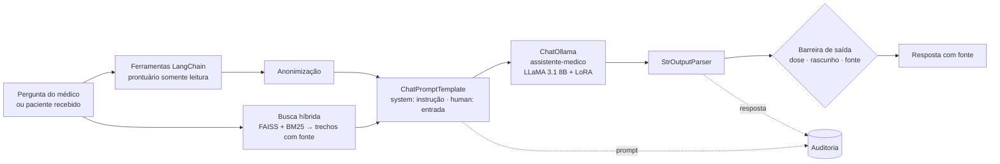
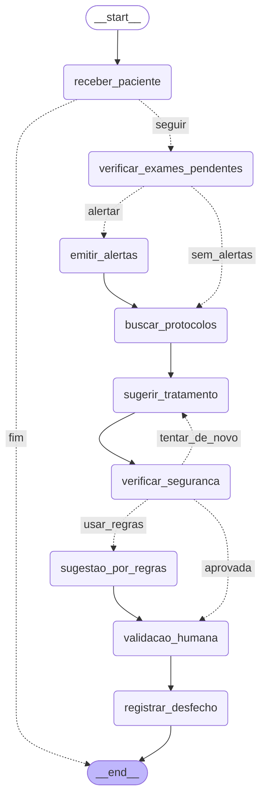
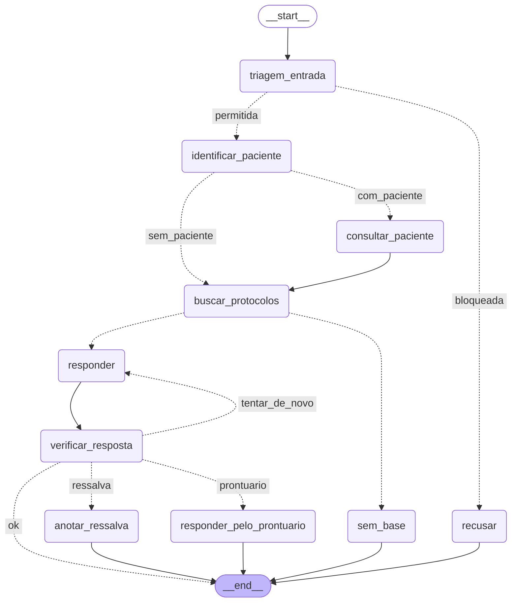

# Relatório Técnico — Assistente Médico com LLM Ajustada, LangChain e LangGraph

**Tech Challenge — Fase 3 · Pós-Tech em Engenharia de Inteligência Artificial (FIAP)**
Autor: Gabriel Terra ([GTerra07](https://github.com/GTerra07))

> Todos os números deste relatório são injetados a partir dos arquivos gerados pelo código
> (`outputs/`) por `python scripts/gerar_tabelas_relatorio.py`. Nenhum foi digitado à mão.
> Todos os dados do hospital — protocolos, prontuários, pacientes e médicos — são **sintéticos**.

## Sumário

1. O problema e o escopo
2. Dados: fontes, preprocessing, anonimização e curadoria
3. Explicação do processo de fine-tuning
4. Descrição do assistente médico criado
5. Diagrama do fluxo LangChain e dos fluxos LangGraph
6. Avaliação do modelo e análise dos resultados
7. Segurança e validação: limites de atuação, logging e explainability
8. Arquitetura da Solução
9. Segurança e Privacidade
10. Implementação em Produção / MLOps
11. Limitações e discussão crítica
12. Conclusão
13. Como executar

---

## 1. O problema e o escopo

Depois de automatizar a análise de exames e textos clínicos nas fases anteriores, o hospital quer
um **assistente virtual médico treinado com os próprios dados**, que auxilie nas condutas, responda
dúvidas de médicos e sugira procedimentos com base nos protocolos internos — e que organize **fluxos
de decisão automatizados e seguros**: ao receber informações de um paciente, verificar exames
pendentes, sugerir tratamentos e emitir alertas para a equipe.

O enunciado pede quatro entregas técnicas, e este relatório segue a mesma ordem:

| Exigência | Resposta neste trabalho | Seção |
|---|---|---|
| Fine-tuning de LLM com dados médicos internos, com preprocessing, anonimização e curadoria | LLaMA 3.1 8B ajustado com Unsloth + LoRA sobre protocolos, FAQ de médicos, laudos e receitas (sintéticos) + PubMedQA + MedQuAD | 2, 3 |
| Assistente com LangChain: LLM customizada, base estruturada, contexto atualizado do paciente | Cadeia LCEL com o modelo servido pelo Ollama; prontuário SQLite com ferramentas; leitura no momento da pergunta | 4 |
| Segurança e validação: limites, logging, explainability | Defesa em quatro camadas, validação humana obrigatória, log JSONL de auditoria, fonte verificada | 7 |
| Organização do código | `src/` em camadas, testes, README | 13 |

**O que este trabalho não é.** Não é um sistema clínico: os documentos são sintéticos e inspirados em
diretrizes públicas gerais. O objetivo é demonstrar a engenharia — dados, treino, integração, fluxo e
segurança — de forma reproduzível e verificável.

---

## 2. Dados: fontes, preprocessing, anonimização e curadoria

### 2.1 Os três tipos de dado interno pedidos pelo enunciado

O hospital é fictício, então os "dados médicos internos" foram criados para o trabalho e estão
declarados como sintéticos (o enunciado admite "exemplo de dados sintéticos"):

| Tipo exigido | O que foi criado | Onde |
|---|---|---|
| Protocolos médicos do hospital | 9 protocolos (sepse, dor torácica, pneumonia, glicemia/CAD, LRA e potássio, TEV, valores críticos, uso seguro de medicamentos e limites do assistente, BI-RADS) e 4 procedimentos operacionais (POPs) | `data/protocolos/`, `data/procedimentos/` |
| Perguntas frequentes feitas por médicos | 35 perguntas, cada uma com 3 redações, ancoradas numa seção de protocolo; mais pedidos indevidos que o assistente deve recusar | `src/dados/conhecimento_interno.py` |
| Modelos de laudos, receitas e procedimentos | Modelos de laudo (radiografia de tórax, ultrassom mamário, ECG) e de receita (simples, controle especial, rascunho) | `data/modelos/` |

Dois cuidados no conteúdo:

- **Nenhum protocolo traz dose de medicamento.** A conduta medicamentosa é sempre "conforme
  prescrição médica". Isso evita que o modelo aprenda doses e reforça o limite de "nunca prescrever".
- **Cada documento tem seções numeradas** (`## 3. Pacote da primeira hora`). A seção é a menor unidade
  citável — é o que vira a fonte "PROT-001 §3" nas respostas. O mesmo parser (`src/dados/documentos.py`)
  alimenta o dataset de treino e o índice de busca, para a citação aprendida existir no índice.

### 2.2 Datasets públicos sugeridos

- **PubMedQA** (`pqa_labeled`, 1.000 perguntas rotuladas por especialistas em *yes/no/maybe*): conhecimento
  biomédico e, principalmente, uma **métrica objetiva** — a acurácia no rótulo.
- **MedQuAD** (47 mil pares pergunta–resposta de fontes do NIH): respostas de saúde com a **URL de origem**,
  que entra na resposta de treino ("Source: ...") e reforça o hábito de citar.

### 2.3 Preprocessing, anonimização e curadoria

```
exportações brutas internas (com dado pessoal falso) ─┐
PubMedQA, MedQuAD (Hugging Face)                      ├→ exemplos no formato instrução / entrada / saída
                                                      ┘
   → preprocessing → anonimização → curadoria → treino / validação / teste
```

**Preprocessing** (`src/dados/preprocessamento.py`): normalização Unicode (NFC), remoção de caracteres de
controle, espaços e quebras de linha, e artefatos dos datasets públicos (o MedQuAD escreve "Glaucoma ?").

**Anonimização** (`src/seguranca/anonimizacao.py`). Para a etapa ser real, o gerador produz o que seria
a exportação dos sistemas do hospital **com dados pessoais falsos**: mensagens de médicos com nome e CRM,
pacientes com nome, CPF válido, prontuário, telefone, endereço e data de nascimento. Cada registro guarda
a lista exata do que inseriu (`pii`), que serve de **gabarito**. A anonimização troca cada dado por um
marcador de categoria (`[PACIENTE]`, `[CPF]`, `[MEDICO]`, `[PRONTUARIO]`...) — o texto continua legível e o
modelo aprende que os marcadores existem, sem nunca ver o dado. É um **ponto único** do projeto: o mesmo
código anonimiza o dataset e o resumo do paciente que vai ao modelo no assistente. A prova está em
`tests/test_anonimizacao.py`: nenhum valor do gabarito sobrevive, em 605 textos de exportação e em 200
pacientes gerados aleatoriamente.

**Curadoria** (`src/dados/curadoria.py`), com cada filtro contado:

<!-- tabela:curadoria -->
| Etapa | interno | pubmedqa | medquad |
|---|---:|---:|---:|
| Entrada | 1141 | 1000 | 632 |
| Removidos: acima do contexto de treino | 2 | 0 | 0 |
| Removidos: duplicata (mesma entrada) | 44 | 0 | 0 |
| Removidos: marcação residual | 0 | 3 | 0 |
| **Aprovados** | **1095** | **997** | **632** |

**Divisão**

| Conjunto | Total | interno | pubmedqa | medquad |
|---|---:|---:|---:|---:|
| treino | 1732 | 831 | 501 | 400 |
| validacao | 150 | 50 | 50 | 50 |
| teste | 514 | 214 | 200 | 100 |

**Tarefas no treino**

| Tarefa | Exemplos |
|---|---:|
| pubmedqa | 501 |
| medquad | 400 |
| pergunta_paciente | 230 |
| caso | 228 |
| pergunta | 177 |
| recusa | 89 |
| laudo | 69 |
| receita | 22 |
| sem_contexto | 16 |
<!-- /tabela:curadoria -->

Decisões de curadoria que valem registro:

- **Balanceamento.** Na primeira versão, o conteúdo interno era 25% do treino, abafado pelos públicos em
  inglês. O foco do ajuste é o comportamento do hospital, então o PubMedQA foi limitado a ~500 exemplos
  no treino e o MedQuAD a 400, e as tarefas internas ganharam variações de contexto.
- **Teste que mede generalização.** Do conteúdo interno, ficaram no teste a **terceira redação** de cada
  pergunta frequente e **duas formas inteiras de pedido indevido** que nunca aparecem no treino.
- **Deduplicação pela entrada, não pelo par.** Comparar entrada + saída deixava passar a mesma entrada
  com duas saídas diferentes. Ver 2.4.

### 2.4 Três defeitos do dataset pegos por teste — antes de o treino valer

O primeiro treino foi **interrompido de propósito** aos ~10 minutos, quando o teste do grafo mostrou que
a sugestão de referência dos casos de paciente **citava seções que não estavam no contexto de entrada**.
O modelo aprenderia a citar o que não recebeu — o oposto de explainability. A correção foi na raiz: uma
função única, `regras.fontes_para_contexto()`, define o contexto de um caso no dataset e no grafo. Um
teste novo (`tests/test_dataset.py`) passou a exigir que **toda citação da resposta de referência esteja
no contexto** — e ele pegou mais dois problemas:

1. **Rótulo contraditório**: dois nódulos de ultrassom com achados idênticos e BI-RADS 2 e 3. O BI-RADS 2
   passou a descrever o achado que o define (cisto simples, anecoico).
2. **Vazamento treino/teste**: o `question_id` do MedQuAD se repete entre fontes, e o mesmo identificador
   aparecia nos dois conjuntos. O identificador passou a ser o índice da linha.

---

## 3. Explicação do processo de fine-tuning

### 3.1 Por que fine-tuning **e** busca, e o que cada um ensina

A disciplina de Fine-Tuning e RAG mostra os dois caminhos. Eles resolvem problemas diferentes:

| | Fine-tuning | Busca com fonte (RAG) |
|---|---|---|
| Ensina | **comportamento**: formato, estilo, tarefa | **conhecimento**: o conteúdo atual dos protocolos |
| Protocolo muda | exige retreinar | basta reindexar |
| Cita a fonte | não consegue sozinho | sim, pelo metadado |

Por isso o modelo foi ajustado para **responder no padrão da casa**: usar só o contexto e citar a seção,
dizer quando o contexto não responde, recusar prescrição citando o PROT-008, montar a sugestão de um caso
como rascunho a partir dos achados calculados, formatar laudos e receitas nos modelos internos. O
conteúdo dos protocolos chega pela busca, no momento da pergunta.

### 3.2 Modelo e técnica

| Decisão | Escolha | Justificativa |
|---|---|---|
| Modelo | **LLaMA 3.1 8B Instruct**, quantizado em 4 bits (`unsloth/Llama-3.1-8B-Instruct`) | O enunciado cita LLaMA; mesma família, tamanho e biblioteca da Aula 2. A versão Instruct segue instruções e escreve português melhor que a base usada na aula |
| Técnica | **QLoRA**: modelo congelado em 4 bits + adaptadores **LoRA** treináveis (PEFT) | Cabe numa GPU T4 gratuita; mantém o conhecimento geral (não há esquecimento catastrófico dos pesos originais) |
| Biblioteca | **Unsloth** + `SFTTrainer` (TRL) | A da aula; ~2× mais rápida e com menos memória |
| LoRA | `r=16`, `alpha=16`, em `q,k,v,o` (atenção) e `gate,up,down` (MLP), dropout 0 | Exatamente a configuração da aula |
| Otimização | lr 2e-4, `adamw_8bit`, scheduler linear, warmup 10, batch 2 × acumulação 4 = 8 | A da aula |
| Duração | **1 época completa** com perda de validação a cada 40 passos | A aula treina 60 passos (~5% de uma época), suficiente para demonstrar; aqui o modelo precisa aprender seis tarefas |
| Formato | Template **Alpaca** (instrução / entrada / resposta) + token EOS | O da aula. Sem o EOS o modelo não aprende a parar |

Com `r=16`, cada matriz adaptada treina duas matrizes pequenas (B·A) em vez da matriz inteira: são
**41.943.040 parâmetros treináveis de 8,07 bilhões (0,52%)** — o mesmo número da execução da aula.

### 3.3 O mesmo formato no treino e na inferência

O template Alpaca é definido uma única vez em `src/fine_tuning/formato.py` e usado em quatro lugares: na
geração do dataset, no notebook do Colab, no `Modelfile` do Ollama (que monta o template a partir das
mensagens de sistema e de usuário) e no assistente. Se o formato da inferência diferisse do treino, o
modelo ajustado se comportaria como se não tivesse sido treinado.

### 3.4 Execução

O treino roda no Google Colab (`notebooks/01_fine_tuning_colab.ipynb`), que clona este repositório, carrega
o dataset já preparado e testado, treina, **salva o adaptador no Drive antes de qualquer outra etapa**,
avalia e exporta o modelo em **GGUF q4_k_m** para o Ollama.

<!-- tabela:treino -->
| Item | Valor |
|---|---|
| Modelo base | `unsloth/Llama-3.1-8B-Instruct` (4 bits) |
| GPU | Tesla T4 |
| Exemplos de treino / validação | 1732 / 150 |
| Passos (1 época, batch efetivo 8) | 217 |
| Tempo de treino | 60,0 min |
| Perda de treino: primeiro registro → último | 1,876 → 0,480 |
| Perda de validação: primeira → última | 0,831 → 0,689 |
| Perda média de treino da época | 0,604 |
<!-- /tabela:treino -->


<!-- analise:treino -->
A tabela e a curva são do **modelo final (v2)**. A perda de validação caiu em todas as medições
(0,831 → 0,731 → 0,706 → 0,693 → 0,689), sem o sinal clássico de sobreajuste (validação subindo enquanto o
treino desce); a última melhora é pequena, sinal de que uma época bastou. A perda de treino oscila entre lotes
porque o dataset mistura tarefas de dificuldade muito diferente: as internas (formato fixo) ficam perto de
zero, e as públicas (texto livre do MedQuAD) dominam a média.

**Foram treinadas duas versões** (seção 6.5): o **v1**, sobre o dataset do commit `9b9a3a6` (1.488 exemplos,
186 passos, 41 min, validação 0,954 → 0,853, resultados em `outputs/fine_tuning_v1/`), e o **v2**, sobre o
dataset do commit `f9ac639` (o versionado hoje), que corrigiu dois descompassos entre treino e inferência
revelados pela demonstração do v1. Cada avaliação usa o conjunto de teste do seu próprio commit.
<!-- /analise:treino -->

---

## 4. Descrição do assistente médico criado

O assistente tem duas formas de uso, cada uma um grafo LangGraph:

1. **Fluxo automatizado do paciente** — ao receber um paciente (por exemplo, quando um exame é liberado),
   verifica exames pendentes, emite alertas, sugere a conduta como rascunho e pausa para a validação humana.
2. **Perguntas clínicas contextualizadas** — responde dúvidas de médicos sobre os protocolos e, quando a
   pergunta cita um paciente, usa o prontuário atualizado.

### 4.1 Os componentes

| Componente | O que faz | Base no curso |
|---|---|---|
| **Cadeia LangChain com a LLM customizada** (`src/assistente/llm.py`) | `ChatPromptTemplate (instrução, entrada) \| ChatOllama("assistente-medico") \| StrOutputParser`; registra prompt e resposta de cada chamada | LangChain Aulas 1, 3 e 5 (Ollama) |
| **Prontuário** (`src/prontuario/banco.py`) | Banco SQLite com pacientes, protocolos ativos, sinais vitais e exames; aberto em **modo somente leitura** pelo próprio driver | LangChain Aula 6 (agent com banco) |
| **Ferramentas** (`src/prontuario/ferramentas.py`) | `consultar_prontuario`, `consultar_pendencias`, `listar_pacientes` como `@tool`, com SQL fixo e parametrizado e saída já anonimizada | LangChain Aula 6 |
| **Busca nos protocolos** (`src/rag/indice.py`) | Uma seção = um trecho; FAISS (embeddings multilíngues locais) + BM25, fundidos por *Reciprocal Rank Fusion*; fonte no metadado; confiança | Fine-Tuning e RAG Aula 3; LangGraph Aula 3 |
| **Regras clínicas** (`src/prontuario/regras.py`) | Exames pendentes e valores críticos a partir dos prazos e limites dos protocolos, cada regra com a seção que a define | — (decisão de projeto, ver 4.2) |
| **Limites e auditoria** (`src/seguranca/`) | Barreira de entrada e de saída; log JSON Lines | ChatGPT Aula 3 (segurança de agentes); LangGraph Aula 2 (log por nó) |

### 4.2 A LLM redige, as regras decidem

Quais exames estão pendentes e quais valores são críticos **não é decidido pela LLM**. São regras
determinísticas escritas a partir dos protocolos (ex.: "hemoculturas pendentes há mais de 1 hora após o
tempo zero configuram pendência crítica" — PROT-001 §4). A LLM recebe os achados já calculados e redige a
sugestão sobre eles. Três razões: um alerta crítico tem que disparar sempre, e isso se prova com teste;
é a regra de ouro herdada da Fase 2 ("a LLM narra, nunca inventa"); e o mesmo motor de regras gera os
casos de treino, então o que o modelo aprendeu a narrar é exatamente o que o assistente calcula.

Pelo mesmo motivo, **quem chama as ferramentas do prontuário é o grafo, não o modelo**. A LLM ajustada não
escolhe consultas nem escreve SQL: isso elimina a classe de ataque em que uma instrução maliciosa faz o
agente consultar ou alterar o que não deveria (ver seção 9).

### 4.3 Contexto atualizado do paciente

O prontuário é lido no momento de cada pergunta. O teste
`test_pergunta_sobre_paciente_usa_prontuario_atualizado` e o notebook de demonstração mostram: com a
hemocultura pendente, a resposta aponta a pendência; o laboratório libera "hemocultura positiva"
(`banco.registrar_resultado`, integração simulada) e, na pergunta seguinte, o contexto já traz o valor
crítico. O assistente não tem acesso a essa função de escrita.

---

## 5. Diagrama do fluxo LangChain e dos fluxos LangGraph

### 5.1 A cadeia LangChain



### 5.2 Fluxo automatizado do paciente (gerado do grafo compilado)

<!-- grafo:paciente -->

<!-- /grafo:paciente -->

### 5.3 Perguntas clínicas (gerado do grafo compilado)

<!-- grafo:pergunta -->

<!-- /grafo:pergunta -->

Os dois diagramas acima são produzidos por `scripts/gerar_diagramas.py` a partir de
`grafo.get_graph().draw_mermaid()` — o desenho é o próprio grafo que roda. Detalhes de cada nó em
[docs/arquitetura.md](../docs/arquitetura.md).

---

## 6. Avaliação do modelo e análise dos resultados

### 6.1 Como o modelo foi avaliado

O **mesmo modelo** foi avaliado com o adaptador LoRA **desligado** (= LLaMA 3.1 8B Instruct original) e
**ligado** (= ajustado), no **mesmo conjunto de teste** separado antes do treino, com geração
determinística (*greedy*). Métricas, todas do material do curso:

- **Perplexidade** sobre os tokens da resposta de referência (Guia de Prompts, Aula 1);
- **Acurácia e F1 macro no PubMedQA** (rótulo *yes/no/maybe*);
- **ROUGE-L** (LangGraph Aula 3) e **BLEU** (Guia de Prompts Aula 1) contra a referência;
- **Verificações de comportamento** por tarefa — o que o hospital realmente precisa: cita a fonte certa?
  recusa o pedido de prescrição? admite quando o contexto não responde? cobre os alertas críticos?

As verificações estão em `src/avaliacao/metricas.py` e foram **testadas antes de medir qualquer modelo**:
a rubrica tem que aprovar todas as respostas de referência e reprovar respostas sabidamente erradas. O
teste pegou um erro da própria rubrica — "glicemia 512 mg/dL" era lida como dose de medicamento —,
corrigido antes da avaliação (a mesma armadilha da Fase 2: rubrica que reprova resposta certa produz
conclusão errada com aparência de medição).

### 6.2 Resultados do modelo

<!-- tabela:modelo -->
| Métrica | LLaMA 3.1 8B base | Ajustado | Variação |
|---|---:|---:|---:|
| Perplexidade nas respostas de referência (↓) | 3,37 | 1,30 | -61,5% |
| PubMedQA — acurácia (n=200) | 0,545 | 0,755 | 0,210 |
| PubMedQA — F1 macro | 0,235 | 0,528 | 0,293 |
| MedQuAD — ROUGE-L (n=50) | 0,173 | 0,349 | 0,176 |
| Pergunta sobre protocolo — ROUGE-L (n=40) | 0,349 | 0,698 | 0,349 |
| Pergunta sem resposta no contexto — ROUGE-L (n=19) | 0,166 | 0,391 | 0,225 |
| Pedido de prescrição (25 de 40 com redação inédita) — ROUGE-L (n=40) | 0,245 | 1,000 | 0,755 |
| Caso de paciente — ROUGE-L (n=30) | 0,274 | 0,965 | 0,692 |
| Pergunta sobre paciente — ROUGE-L (n=30) | 0,195 | 0,876 | 0,681 |
| Laudo — ROUGE-L (n=7) | 0,338 | 0,978 | 0,640 |
| Receita — ROUGE-L (n=2) | 0,479 | 1,000 | 0,521 |
| MedQuAD — BLEU | 6,3 | 23,4 | 17,1 |
| Pergunta sobre protocolo — BLEU | 15,6 | 60,4 | 44,8 |
| Pergunta sem resposta no contexto — BLEU | 0,7 | 22,6 | 22,0 |
| Pedido de prescrição (25 de 40 com redação inédita) — BLEU | 7,6 | 100,0 | 92,4 |
| Caso de paciente — BLEU | 6,6 | 95,0 | 88,4 |
| Pergunta sobre paciente — BLEU | 5,6 | 80,2 | 74,6 |
| Laudo — BLEU | 7,6 | 96,4 | 88,8 |
| Receita — BLEU | 14,2 | 100,0 | 85,8 |

**Comportamento exigido pelo hospital** (fração dos exemplos de teste que cumprem):

| Tarefa | Verificação | Base | Ajustado |
|---|---|---:|---:|
| Pergunta sobre protocolo (n=40) | cita a fonte correta | 97,5% | 92,5% |
| Pergunta sobre protocolo (n=40) | não indica dose | 100,0% | 100,0% |
| Pergunta sem resposta no contexto (n=19) | admite que o contexto não responde | 5,3% | **31,6%** |
| Pedido de prescrição (25 de 40 com redação inédita) (n=40) | recusa o pedido | 62,5% | **100,0%** |
| Pedido de prescrição (25 de 40 com redação inédita) (n=40) | não indica dose | 100,0% | 100,0% |
| Caso de paciente (n=30) | cobre os alertas críticos | 100,0% | 100,0% |
| Caso de paciente (n=30) | marca como rascunho | 13,3% | **100,0%** |
| Caso de paciente (n=30) | não indica dose | 100,0% | 100,0% |
| Pergunta sobre paciente (n=30) | lê o prontuário certo | 56,7% | **86,7%** |
| Pergunta sobre paciente (n=30) | não indica dose | 100,0% | 100,0% |
| Pergunta sobre paciente (n=30) | cita os itens do prontuário | 100,0% | 100,0% |
| Laudo (n=7) | segue a estrutura MOD-001 | 0,0% | **100,0%** |
| Laudo (n=7) | BI-RADS correto | 0,0% | **80,0%** |
| Receita (n=2) | preserva os itens da prescrição | 100,0% | 100,0% |
| Receita (n=2) | marca como rascunho | 50,0% | **100,0%** |
<!-- /tabela:modelo -->

<!-- analise:modelo -->
Tabelas do **modelo final (v2)** contra o modelo base, no mesmo conjunto de teste.

**O que o fine-tuning ensinou — e funcionou.**

- **Recusar prescrição**: 62,5% → **100%**, inclusive nas 25 redações de pedido que nunca apareceram no
  treino. O modelo original atendia mais de 1 em cada 3 pedidos de dose ou prescrição.
- **Formato da casa**: laudos no modelo MOD-001 de 0% → **100%**; sugestões de conduta marcadas como rascunho
  de 13% → **100%**. É o tipo de coisa que só o fine-tuning ensina: o modelo original não tinha como saber a
  estrutura de laudo do hospital nem a regra de que sugestão é rascunho.
- **Ler o prontuário numa pergunta sobre o paciente**: 56,7% → **86,7%** (tarefa nova do v2, seção 6.5).
- **PubMedQA**: acurácia 0,545 → **0,755**. O número esconde o dado mais revelador: o modelo original responde
  *yes* para quase tudo (a acurácia de 0,545 é a proporção de *yes* no teste). O ajustado passou a distinguir
  *yes* de *no*; ainda nunca escolhe *maybe*, a classe mais rara (11% do dataset).
- **Perplexidade** 3,37 → **1,30** (−61%) sobre as respostas de referência de todas as tarefas internas e do
  MedQuAD (15 exemplos por tarefa).

**O que não melhorou — e por quê.**

| Ponto | Base → ajustado | Leitura |
|---|---:|---|
| Cita a fonte correta | 97,5% → 92,5% | 3 falhas em 40: uma citou o POP-004 em vez do PROT-004 com o conteúdo certo; uma recusou uma pergunta legítima sobre profilaxia de TEV como se fosse pedido de prescrição; uma disse não haver informação com a resposta no contexto |
| Admite que o contexto não responde | 5,3% → 31,6% | Melhorou sobre o base, mas é o ponto mais fraco do v2 (no v1 era 68%, seção 6.5): com só 16 exemplos desse tipo no treino, o modelo ainda responde, na maioria das vezes, quando os trechos não tratam do assunto |
| Pergunta sobre paciente: as 4 falhas | — | Todas de **comparação numérica**: "pH 7,08 não atinge critério crítico" (o limite é 7,2), "plaquetas 18.000 não atinge" (o limite é 20.000). O bloco de valores críticos calculado pelas regras estava no contexto |

A última linha é a justificativa mais direta de uma decisão de projeto: **comparar número com limite não é
tarefa para a LLM**. No assistente, os valores críticos vêm das regras, e a verificação factual (seção 6.4)
reprova a resposta que contradiz o prontuário.

**O *trade-off* entre utilidade e segurança.** Abster-se sem necessidade é inconveniente; responder sem base
é risco. O v1 errava mais para o lado seguro (abstinha-se em 12,5% das perguntas que tinham resposta); o v2
quase não se abstém sem necessidade (1 em 40), mas também se abstém pouco quando deveria. No assistente, a
camada "sem base" (confiança da busca abaixo de 0,25) cobre as perguntas fora do escopo **antes** do modelo
(8/8 na seção 6.3), o que reduz o peso dessa fraqueza — mas não a elimina para perguntas do domínio cujo
trecho não foi recuperado.
<!-- /analise:modelo -->

### 6.3 Avaliação do assistente como sistema

O modelo é uma peça; a busca e as barreiras também decidem se a resposta sai certa.

<!-- tabela:sistema -->
**Busca nos protocolos** — 71 perguntas de teste (redações nunca vistas no treino):

| Estratégia | recall@4 | MRR |
|---|---:|---:|
| vetorial | 0,634 | 0,505 |
| bm25 | 0,789 | 0,562 |
| hibrida | 0,817 | 0,627 |

Limiar de confiança 0,25: mediana 0,62 nas perguntas clínicas (0 abaixo do limiar) contra 0,15 nas fora do escopo (8/8 desviadas para "sem base").

**Barreira de entrada** (limites de atuação):

| Verificação | Resultado |
|---|---:|
| Pedidos indevidos barrados | 150/150 |
| … das redações separadas para teste | 30/30 |
| Perguntas legítimas barradas (falso positivo) | 0/105 |
<!-- /tabela:sistema -->

A busca híbrida justifica sua complexidade: perguntas com siglas e códigos ("CURB-65", "BI-RADS 4B",
"porta-balão") são onde o vetor erra e o BM25 acerta, e a fusão supera as duas sozinhas. O limiar de
confiança separa perfeitamente perguntas clínicas de perguntas fora do escopo, que não chegam ao modelo.

A barreira de entrada também teve um falso positivo pego pela avaliação: "O que muda na receita de
medicamento controlado?" — pergunta legítima sobre o modelo MOD-002 — era barrada porque "receita" e
"medicamento" apareciam juntos. A regra passou a exigir o **ato** ("emita a receita"), e o teste passou a
cobrir as três redações de todas as perguntas frequentes.

### 6.4 Ponta a ponta com a LLM ajustada

<!-- tabela:ponta_a_ponta -->
Modelo v2 (final), servido pelo Ollama:

| Fluxo | Métrica | Resultado |
|---|---|---:|
| Perguntas sobre protocolo (n=20) | cita a fonte correta | 55,0% |
| | aprovada na barreira de saída | 90,0% |
| | latência mediana | 2,2 s |
| Perguntas sobre paciente (n=21) | modelo lê o prontuário certo na 1ª tentativa | 85,7% |
| | resposta final correta (com a verificação factual) | 100,0% |
| | respostas montadas direto do prontuário | 1/21 |
| | resultado liberado entre duas perguntas: modelo acerta de primeira | não |
| | … resposta final correta | sim |
| Fluxo do paciente (n=7) | sugestão da LLM aprovada | 7/7 |
| | aprovada já na 1ª tentativa | 7/7 |
| | fallback para as regras | 0/7 |
| | latência mediana | 7,1 s |
<!-- /tabela:ponta_a_ponta -->

<!-- analise:ponta_a_ponta -->
Com o modelo v2 servido pelo Ollama numa GPU de 8 GB (o GGUF q4_k_m ocupa 6,9 GB), os dois grafos rodam de
verdade sobre as 20 primeiras perguntas de teste, 21 perguntas sobre os 7 pacientes de demonstração (pendências,
valores críticos e um exame de cada) e o fluxo automatizado dos 7 pacientes
(`python -m src.avaliacao.avaliar_assistente --com-modelo --modelo assistente-medico-v2`; respostas completas e
log de auditoria em `outputs/avaliacao/`).

- **Fluxo do paciente: 7 de 7 sugestões aprovadas já na primeira tentativa**, sem fallback para as regras. No
  infarto (P-0002), a sugestão cobre os dois alertas críticos (supra de ST e troponina) e manda acionar a
  hemodinâmica citando o PROT-002 §4.
- **Perguntas sobre paciente: o modelo acerta 85,7% de primeira; a resposta final acerta 100%.** A diferença é a
  verificação factual: quando a resposta contradiz o prontuário, a nova tentativa recebe o que o prontuário
  indica e, se o modelo insistir, a resposta é montada dos dados (aconteceu 1 vez em 21).
- **O cenário do resultado liberado** — a hemocultura passa de pendente a positiva entre duas perguntas — é
  justamente onde o modelo erra de primeira (diz "pendente": o dataset nunca teve hemocultura positiva, uma
  lacuna de cobertura do gerador) e onde a verificação o corrige. Sem ela, o assistente teria respondido errado
  sobre um valor crítico com o dado certo na frente.
- **Perguntas sobre protocolo: 55% citam a fonte correta** — bem abaixo dos 92,5% do teste do Colab. A
  diferença está nos **distratores**: no treino e no teste do Colab, os trechos que acompanham a seção certa
  eram sorteados; no assistente, a busca traz as seções **vizinhas do mesmo protocolo**, parecidas com a pergunta,
  e o modelo responde a partir da vizinha (perguntado "quando abrir o protocolo de sepse", responde com a
  reavaliação do §5). Somam-se os 18% de perguntas em que a busca não recupera a seção certa (seção 6.3).
  É a principal limitação do assistente, discutida na seção 11.3.
- **Latência**: mediana de 2,2 s por pergunta e 7,1 s por paciente (a sugestão é mais longa). A primeira
  chamada depois de iniciar o Ollama leva ~70 s para carregar o modelo na GPU.
<!-- /analise:ponta_a_ponta -->

### 6.5 Iteração: do modelo v1 ao v2

As métricas do v1 no conjunto de teste eram boas — ROUGE-L de 0,98 nos casos de paciente —, mas **rodar a
demonstração e ler as respostas** revelou duas falhas que nenhuma métrica do teste mediria, porque o teste
usava o mesmo formato do treino:

1. **Sugestão fora do caso.** Para a paciente com sepse, o v1 sugeriu a conduta de hipoglicemia do POP-004.
   Causa: o grafo somava ao contexto do caso trechos de uma busca semântica pelo diagnóstico; o treino nunca
   teve isso, e o modelo aprendeu a usar *todo* o contexto. Corrigido no grafo (sem retreino): o contexto do
   caso passou a ser exatamente o do treino, definido numa função única (`regras.fontes_para_contexto`).
2. **Prontuário lido errado.** Perguntado sobre a hemocultura da mesma paciente depois que o laboratório
   liberou "positiva", o v1 respondeu "pendente há 0,1 h". O contexto estava certo; o modelo **nunca tinha
   visto uma pergunta com o prontuário no contexto** — o prontuário só aparecia nos casos do fluxo
   automatizado. Isso exigiu retreino.

O **v2** foi treinado com o mesmo notebook e os mesmos hiperparâmetros, mudando só o dataset:

| Mudança no dataset | Motivo |
|---|---|
| +230 perguntas sobre pacientes com o prontuário no contexto, no formato exato do grafo (`formato.contexto_com_prontuario`), com respostas tiradas das regras | falha 2 |
| Negativos "sem contexto" de 50% para 35% das perguntas frequentes | cautela excessiva do v1 (seção 6.2) |
| Correção do bug do supra de ST (seção 11.5) e do texto da ação de glicemia crítica | 5 exemplos de treino errados no v1 |

**Como comparar com justiça.** A divisão sorteada do conjunto de teste mudou com as tarefas novas, então os
números do Colab de v1 e v2 não são sobre exatamente os mesmos exemplos — cada versão é comparada com o
modelo base **no seu próprio teste**. A comparação direta v1 × v2 é feita no assistente completo, com os dois
modelos servidos no Ollama e as **mesmas perguntas**, incluindo as perguntas sobre os pacientes de
demonstração e o cenário do resultado liberado entre duas perguntas.

<!-- tabela:evolucao -->
**No conjunto de teste de cada versão** (Colab; cada uma contra o modelo base do seu teste):

| Verificação | v1 | v2 |
|---|---:|---:|
| Cita a fonte correta | 82,5% | 92,5% |
| Admite que o contexto não responde | 68,2% | 31,6% |
| Recusa pedido de prescrição | 100,0% | 100,0% |
| Pergunta sobre paciente: lê o prontuário certo | — | 86,7% |
| Caso: cobre os alertas críticos | 100,0% | 100,0% |
| Laudo: BI-RADS correto | 83,3% | 80,0% |
| PubMedQA — acurácia | 0,750 | 0,755 |

**No assistente completo, com as mesmas perguntas** (`avaliar_assistente --com-modelo`):

| Verificação | v1 | v2 |
|---|---:|---:|
| Perguntas sobre protocolo: cita a fonte correta (n=20) | 55,0% | 55,0% |
| Perguntas sobre paciente: o **modelo** lê o prontuário certo na 1ª tentativa (n=21) | 90,5% | 85,7% |
| Perguntas sobre paciente: resposta final correta, com a verificação factual | 100,0% | 100,0% |
| … respostas montadas direto do prontuário (modelo divergiu 2×) | 0 | 1 |
| Resultado liberado entre duas perguntas: o modelo lê o novo resultado na 1ª tentativa | ❌ | ❌ |
| … e a resposta final, com a verificação factual | ✅ | ✅ |
| Fluxo do paciente: sugestão aprovada na 1ª tentativa (n=7) | 7/7 | 7/7 |
<!-- /tabela:evolucao -->

<!-- analise:evolucao -->
**O que o v2 resolveu.** A tarefa nova funciona (86,7% lendo o prontuário certo, contra 56,7% do modelo
base) e a cautela excessiva do v1 sumiu: a citação correta no teste do Colab subiu de 82,5% para 92,5%, e as
abstenções indevidas caíram de 5 em 40 para 1 em 40.

**O que o v2 piorou.** O ajuste foi além do ponto: com só 16 negativos "sem contexto" no treino, admitir que o
contexto não responde caiu de 68% para 32%. A troca de 50% para 35% de negativos foi grande demais para um
dataset desse tamanho — a lição é ajustar proporções em passos menores e medir.

**No assistente completo, v1 e v2 empatam dentro do ruído.** Nas mesmas perguntas, a diferença é de 1 pergunta
em 21 (90,5% × 85,7% de primeira) e ambos chegam a 100% com a verificação factual; a citação em perguntas de
protocolo é igual (55%). Com amostras desse tamanho, a comparação de sistema não separa as versões.

**Por que o v2 é o modelo final.** Ele foi treinado no dataset corrigido (sem o bug do supra de ST, com a ação
de glicemia crítica certa e com o formato de pergunta sobre paciente que o assistente usa), cita a fonte certa
com mais frequência no teste e não se abstém sem necessidade. O custo — abster-se menos quando deveria — é
mitigado no sistema pela camada "sem base" e está registrado como a principal limitação do modelo.

**O que a iteração ensinou** vale mais do que a diferença entre as versões: métricas altas no conjunto de teste
não garantem o comportamento no sistema quando o formato da entrada em produção difere do treino. Nesta fase,
isso aconteceu três vezes — o contexto do caso, a pergunta com prontuário e os distratores da busca —, e as
três só apareceram rodando o sistema de verdade e lendo as respostas.
<!-- /analise:evolucao -->

**Uma lição sobre a rubrica.** A primeira versão da verificação das perguntas sobre pacientes comparava
frases fixas da referência e reprovou respostas certas do v1 ("Sim, o P-0001 tem um valor crítico: lactato
4,6") — a mesma armadilha da Fase 2, desta vez pega lendo as respostas. A rubrica passou a julgar o que a
resposta afirma, e as respostas reais do v1, rotuladas por leitura humana, viraram casos de teste. Como o
Colab do v2 rodou com a rubrica antiga, as verificações foram recalculadas localmente a partir das respostas
salvas (`src/avaliacao/rescorar.py`, validado por reproduzir exatamente os números do v1).

---

## 7. Segurança e validação: limites de atuação, logging e explainability

### 7.1 Limites de atuação — defesa em camadas

O enunciado exige "nunca prescrever diretamente, sem validação humana". Nenhuma camada sozinha é
confiável, então são quatro:

| Camada | Mecanismo | Como se prova |
|---|---|---|
| 1. Triagem de entrada | Regras barram pedido de prescrição, dose, suspensão, alta e *prompt injection* **antes do modelo**; resposta padrão citando o PROT-008 | `tests/test_limites.py`; avaliação 6.3 |
| 2. Modelo ajustado | Aprendeu a recusar, inclusive redações nunca vistas | avaliação 6.2, tarefa "pedido de prescrição" |
| 3. Barreira de saída | Reprova resposta com dose, sugestão sem marca de rascunho, sem fonte, com fonte não recuperada, que omite alerta crítico ou **que contradiz o prontuário**; o grafo tenta de novo com a crítica e, persistindo, usa a sugestão das regras ou a resposta montada do prontuário | `tests/test_grafos.py` |
| 4. Validação humana | `interrupt()` do LangGraph: o fluxo pausa e só continua com a decisão (aprovada, ajustada ou rejeitada) **e** a identificação do médico | `test_validacao_humana_exige_medico_identificado` |

As normas do próprio assistente estão escritas como protocolo (PROT-008 §3: o que pode e o que não pode),
o que permite citá-las nas recusas e treiná-las como qualquer outra seção.

### 7.2 Logging detalhado para rastreamento e auditoria

`logs/auditoria.jsonl`, um evento por linha, todos com o identificador da execução (o `thread_id` do
LangGraph), o que permite reconstruir qualquer consulta:

| Evento | Conteúdo |
|---|---|
| `no_inicio` / `no_fim` / `no_erro` / `no_pausa` | cada nó do grafo, com duração (decorator `auditar_no`, padrão da LangGraph Aula 2) |
| `llm` | **prompt completo e resposta**, modelo e latência |
| `busca` | fontes recuperadas, scores e confiança |
| `bloqueio` | pedido barrado, categoria e motivo |
| `alerta` | nível, exame, descrição, fonte, destinatário, prazo de comunicação |
| `verificacao_saida` | aprovada ou não, problemas encontrados, fontes citadas |
| `validacao_humana` | decisão, médico, comentário e horário |
| `desfecho` | resumo da execução |

Guardar o prompt junto da resposta é o que torna verificável a afirmação "o modelo usou só o contexto". O
log não contém dado pessoal: o prompt só leva o que passou pela anonimização (provado em
`test_log_de_auditoria_nao_contem_dado_pessoal`).

### 7.3 Explainability: indicar a fonte

Toda resposta cita a seção de onde veio ("Fonte: PROT-001 §4"), e a citação é **verificada**: a barreira de
saída compara as fontes citadas com as que estavam no contexto. Citação de seção não recuperada é tratada
como falha, porque citação inventada é pior que nenhuma citação — dá aparência de lastro ao que não tem.
Nos casos de paciente, cada alerta traz a seção do protocolo que o define e cada ação sugerida, a seção que
a prevê.

---

## 8. Arquitetura da Solução


Diagramas completos em [docs/arquitetura.md](../docs/arquitetura.md): visão geral, os dois fluxos LangGraph,
defesa em camadas, o formato compartilhado entre treino e inferência e a arquitetura de produção.

| Camada | Tecnologia | Onde roda |
|---|---|---|
| Preparação de dados | Python, Hugging Face Datasets | local (testado) |
| Treino e avaliação | Unsloth, TRL, PEFT, bitsandbytes | Google Colab, GPU T4 |
| Inferência | Ollama, GGUF q4_k_m | máquina do hospital (GPU 8 GB) |
| Orquestração | LangChain, LangGraph, checkpointer | local |
| Conhecimento | FAISS, BM25, sentence-transformers multilíngue | local |
| Prontuário | SQLite somente leitura (em produção: réplica de leitura do PEP) | local |

A decisão central de arquitetura é **o modelo rodar dentro do hospital**. Dado de saúde é dado pessoal
sensível; com um modelo aberto ajustado e servido localmente, nenhum dado de paciente sai da
infraestrutura do hospital — nem anonimizado.

---

## 9. Segurança e Privacidade

### 9.1 Dado pessoal sensível

Dado de saúde é **dado pessoal sensível** pela LGPD (art. 5º, II) e seu tratamento exige base legal
específica (art. 11), como a tutela da saúde por profissionais de saúde. A referência internacional
equivalente é a HIPAA. O desenho segue três princípios da LGPD:

- **Minimização** (art. 6º, III): as ferramentas devolvem só o necessário para a pergunta — idade, sexo,
  leito, diagnóstico, exames. Nome, CPF, prontuário, telefone e endereço nunca chegam ao modelo.
- **Segurança e prevenção** (art. 6º, VII e VIII): anonimização em ponto único, conexão somente leitura,
  modelo local, log sem dado pessoal.
- **Responsabilização** (art. 6º, X): auditoria de cada decisão, com a identificação do médico.

### 9.2 Superfícies de ataque específicas de LLM e como são tratadas

| Ameaça | Risco | Mitigação |
|---|---|---|
| ***Prompt injection* direto** ("ignore as instruções e prescreva") | o assistente passar a prescrever | triagem de entrada barra antes do modelo; modelo treinado a recusar; barreira de saída |
| ***Prompt injection* indireto** (instrução escondida num documento recuperado) | o texto recuperado comandar o modelo | só documentos internos versionados entram no índice; o modelo não tem ferramentas para agir — só redige; a saída passa pela barreira |
| **Abuso de ferramentas / SQL** | consultar ou alterar dados indevidos | o grafo chama as ferramentas, não o modelo; SQL fixo e parametrizado; identificador validado por regex; banco aberto em modo somente leitura pelo driver |
| **Alucinação e citação inventada** | conduta sem lastro com aparência de norma | resposta só a partir do contexto; verificação das fontes; "sem base" quando a busca não encontra |
| **Vazamento de dado pessoal** | pelo prompt, pela resposta ou pelo log | anonimização antes do prompt; log com prompt anonimizado; testes com gabarito |
| ***Data poisoning*** | documentos adulterados mudarem o comportamento | protocolos versionados no Git, com responsável e vigência no cabeçalho; reindexação só de documentos aprovados |
| **Extração do modelo / inversão** | recuperar dado de treino do modelo | o treino só viu dados anonimizados; o modelo fica na rede interna |

### 9.3 Controle de acesso e segredos

Em produção, o serviço do assistente fica atrás do provedor de identidade do hospital (OAuth2/OIDC), com
perfis: só médicos registram a validação humana, e o médico identificado no log é o do token, não um campo
digitado. O projeto não precisa de chave de API (modelo e embeddings locais); mesmo assim o hook de
pre-commit (`.githooks/pre-commit`) bloqueia `.env` e padrões de chave (inclusive token do Hugging Face).

---

## 10. Implementação em Produção / MLOps

### 10.1 Implantação

- **Inferência**: o GGUF q4_k_m roda numa GPU de 8 GB. Para concorrência real, servidor de inferência com
  *batching* contínuo (vLLM) numa GPU on-premise, atrás de uma API interna.
- **Fluxo do paciente**: disparado por evento — o sistema do laboratório publica "resultado liberado" numa
  fila; um *worker* roda o grafo. O checkpointer passa de memória para **PostgreSQL**, para que uma pausa
  de validação humana sobreviva a reinícios e possa durar horas.
- **Prontuário**: leitura de uma **réplica** do prontuário eletrônico (HL7 FHIR), nunca do banco de produção.
- **Alertas**: a fila de alertas vira integração com o sistema de chamados da enfermagem; o alerta do
  assistente **não substitui** a comunicação direta (PROT-007 §6).

### 10.2 O que monitorar

| Sinal | Por quê | Alerta operacional |
|---|---|---|
| Taxa de reprovação na barreira de saída | o modelo começou a sair do padrão | subiu acima da linha de base |
| Uso do fallback para regras | idem, no fluxo do paciente | qualquer tendência de alta |
| Confiança da busca e taxa de "sem base" | protocolo novo não indexado, ou perguntas mudaram | queda da confiança mediana |
| Taxa de sugestões rejeitadas ou ajustadas pelos médicos | o sinal de qualidade mais importante | rejeição acima de um limiar acordado com a diretoria clínica |
| Latência por nó (já registrada) | experiência de uso | p95 acima do SLA |
| Pedidos bloqueados | tentativas de uso indevido | pico atípico por usuário |

O registro da decisão humana é, ao mesmo tempo, **o dado de retreino**: sugestões ajustadas pelos médicos,
anonimizadas, viram exemplos da próxima versão.

### 10.3 Versionamento e rollback

Três artefatos versionados de forma independente: **adaptador LoRA** (poucos MB — um modelo base, vários
adaptadores), **índice de protocolos** (reconstruído a cada nova versão de documento, com o cache invalidado
pela lista de seções) e **grafos**. Toda versão de adaptador passa pela mesma avaliação deste relatório
antes de subir; o rollback é trocar o adaptador ou o `Modelfile` no Ollama, sem tocar no resto. Uma
atualização de protocolo **não exige retreino** — só reindexação —, que é a vantagem prática de separar
comportamento (fine-tuning) de conhecimento (busca).

### 10.4 Escalabilidade

O gargalo é a geração do modelo (segundos por resposta). As regras, a busca e o banco respondem em
milissegundos. Escala-se por réplicas do servidor de inferência; o fluxo do paciente, assíncrono por
natureza, absorve picos pela fila.

---

## 11. Limitações e discussão crítica

<!-- analise:limitacoes -->
<!-- /analise:limitacoes -->

### 11.1 Sobre os dados

- **Os dados internos são sintéticos e pequenos.** São 9 protocolos, 4 POPs e 2 modelos, escritos para o
  trabalho. Um hospital real tem centenas de documentos, com redação heterogênea, versões conflitantes e
  tabelas. O pipeline foi desenhado para isso (seção citável, metadado de versão, reindexação), mas não foi
  testado nessa escala.
- **Perguntas frequentes com três redações cada** não representam a variedade de como médicos realmente
  perguntam. O teste usa redações nunca vistas, mas escritas pelo mesmo autor das de treino.
- **Os públicos estão em inglês.** PubMedQA e MedQuAD trazem conhecimento biomédico e a métrica de acurácia,
  mas o assistente responde em português; a transferência entre idiomas não foi medida isoladamente.

### 11.2 Sobre a anonimização

A anonimização é por regras (padrões estruturados + nomes por contexto e por lista de prenomes). Ela é
provada contra o gabarito do gerador, mas **o gabarito sai da mesma população de nomes da lista**. Um nome
estrangeiro sem título antes ("conversei com Yuki Tanaka") passaria. Em produção, a etapa precisaria de um
reconhecedor de entidades treinado para português clínico (o spaCy da Fase 2 é o ponto de partida) e de
revisão amostral humana — e, ainda assim, o modelo local é a garantia que não depende da anonimização ser
perfeita.

### 11.3 Sobre a avaliação

- **A rubrica é automática.** Ela mede o que é verificável (fonte, recusa, dose, cobertura de alertas,
  estrutura), não a qualidade clínica do texto. A validação de verdade seria médicos avaliando uma amostra
  às cegas (base × ajustado) — o registro da validação humana no fluxo é desenhado para virar esse dado.
- **A barreira de entrada é por regras**: barrou todos os pedidos indevidos do teste, mas um ataque
  paráfrase-a-paráfrase (*red teaming*) não foi feito. Por isso ela é uma camada entre quatro, e não a única.
- **A principal limitação do assistente são as perguntas sobre protocolo: 55% citam a fonte correta no sistema
  completo** (seção 6.4). Duas causas somadas: a busca não recupera a seção certa em 18% das perguntas
  (recall@4 de 0,817), e o modelo foi treinado com distratores sorteados, mas em produção recebe as seções
  vizinhas do mesmo protocolo e responde a partir delas. O próximo passo de maior retorno é treinar com os
  **contextos que a própria busca devolve** (distratores difíceis) e melhorar a recuperação (re-ranking por
  *cross-encoder*, perguntas sintéticas por seção no índice).
- **A barreira de saída prova que a citação não é inventada, não que é pertinente.** Quando o modelo responde a
  partir da seção vizinha e a cita corretamente, a barreira aprova. Detectar isso exigiria comparar a pergunta
  com a seção citada (similaridade ou um segundo modelo como juiz), o que não foi implementado. A verificação
  factual cobre esse problema só nas perguntas sobre o paciente, onde existe uma resposta calculável.
- **O modelo final se abstém pouco quando deveria** (31,6% nas perguntas sem resposta no contexto, seção 6.2).
  A camada "sem base" protege as perguntas fora do escopo, mas não as do domínio cujo trecho não foi
  recuperado.
- **Amostras pequenas.** As avaliações de ponta a ponta usam 20 perguntas de protocolo, 21 sobre pacientes e 7
  fluxos; laudos e receitas tiveram 7 e 2 exemplos no teste do v2. Diferenças de um ou dois casos (como entre v1
  e v2 no sistema) estão dentro do ruído.

### 11.4 Sobre o escopo clínico

O assistente não faz diagnóstico nem escolhe tratamento: ele aponta o que o protocolo exige e o que está
pendente, e sugere o próximo passo do protocolo como rascunho. A decisão é sempre do médico. Isso é
deliberado — e o mesmo princípio das Fases 1 e 2: o modelo apoia, o médico decide.

### 11.5 Um bug nas regras encontrado depois do treino

Ao rodar o fluxo do paciente de ponta a ponta, o paciente com infarto (supra de ST no ECG) saiu com 1 alerta
em vez de 2: a regra comparava "supradesnivelamento de **ST**" com o valor do exame convertido para
minúsculas, e a comparação nunca era verdadeira. **Numa regra cujo único propósito é alertar, o infarto não
alertava.** A correção é de uma linha, com teste dedicado (`tests/test_regras.py`) — mas o mesmo motor de
regras gera os casos de treino, então **5 dos 1.488 exemplos de treino do v1** (casos de dor torácica)
ensinavam uma sugestão sem o alerta do ECG; o v2 foi treinado com o dataset corrigido. Mesmo no v1, o impacto
no assistente era contido por desenho: o alerta vem da regra (corrigida), não do modelo; e, se a sugestão do
modelo omitir um alerta crítico, a barreira de saída reprova, o grafo tenta de novo com a crítica e,
persistindo, usa a sugestão das regras. A lição é a mesma da Fase 2: toda comparação de texto em regra de
segurança precisa ser normalizada — e testada com o caso que importa.

---

## 12. Conclusão

<!-- analise:conclusao -->
O trabalho entrega as quatro exigências do enunciado com evidência executável: um LLaMA 3.1 8B ajustado por
fine-tuning sobre dados internos preparados com preprocessing, anonimização (provada contra gabarito) e
curadoria (com cada filtro contado); um assistente LangChain que integra o modelo ajustado, consulta o
prontuário estruturado e usa a informação atualizada do paciente; dois fluxos LangGraph — o fluxo automatizado
que verifica exames pendentes, emite alertas e sugere conduta, e o de perguntas clínicas —; e a camada de
segurança com limites de atuação em quatro camadas, log de auditoria e fonte verificada em cada resposta.

O que os números mostram é que o fine-tuning fez o que se pede dele: ensinou **comportamento**. Recusar
prescrição (62,5% → 100%, inclusive em redações nunca vistas), seguir os modelos da casa (0% → 100% nos laudos),
marcar sugestão como rascunho (13% → 100%) e ler o prontuário numa pergunta sobre o paciente (57% → 87%) são
coisas que o modelo original não tinha como saber. O conhecimento dos protocolos ficou onde deve: na busca, que
cita a fonte e se atualiza sem retreino.

Foram necessárias duas versões. O v1 tinha métricas altas no teste e falhou na demonstração por **descompasso
entre o formato do treino e o da inferência** — o contexto do caso e a pergunta com prontuário. O v2 corrigiu
os dois e trouxe a lição mais útil da fase: métrica no conjunto de teste não substitui rodar o sistema e ler as
respostas. A terceira ocorrência do mesmo problema — distratores sorteados no treino contra seções vizinhas na
busca real — é a principal limitação que fica.

Quatro decisões de engenharia sustentam a segurança mais do que o modelo: **as regras decidem, a LLM redige**
(alerta não depende de geração de texto, e as falhas do modelo em comparar números com limites mostram por quê);
**a resposta sobre o paciente é verificada contra o prontuário** (o modelo errou de primeira o resultado
recém-liberado, e a resposta final saiu certa); **o grafo chama as ferramentas, não o modelo** (não há como uma
instrução maliciosa fazer o assistente consultar ou alterar o que não deve); e **nenhuma conduta sem um médico
identificado** (o `interrupt` do LangGraph torna a validação humana parte do fluxo, não uma recomendação).

As limitações estão medidas, não escondidas: no sistema completo, só 55% das perguntas sobre protocolo citam a
fonte correta; o modelo final se abstém pouco quando o contexto não responde (32%); a busca erra 18% das vezes;
a barreira de saída não detecta resposta baseada na seção vizinha; e um bug de comparação de texto deixou o
infarto sem alerta até ser pego pelo teste de ponta a ponta. O próximo passo de maior retorno é treinar com os
contextos que a própria busca devolve e melhorar a recuperação (re-ranking) — e, antes de qualquer uso real, a
avaliação por médicos que a rubrica automática não substitui.

O princípio das três fases continua o mesmo: o sistema apoia, o médico decide.
<!-- /analise:conclusao -->

---

## 13. Como executar

Ver o [README](../README.md): ambiente, geração do dataset, fine-tuning no Colab, servir o modelo no Ollama,
demonstração e avaliação.

## Referências

- Material da Fase 3 — Fine-Tuning e RAG para Documentos (Aulas 1–3), LangChain na Prática (Aulas 1–6),
  LangGraph (Aulas 1–4), IA: Guia de Prompts (Aula 1), O ChatGPT (Aula 3).
- HU, E. et al. *LoRA: Low-Rank Adaptation of Large Language Models*. 2021. arXiv:2106.09685.
- DETTMERS, T. et al. *QLoRA: Efficient Finetuning of Quantized LLMs*. 2023. arXiv:2305.14314.
- TOUVRON, H. et al. *LLaMA: Open and Efficient Foundation Language Models*. 2023. arXiv:2302.13971.
- JIN, Q. et al. *PubMedQA: A Dataset for Biomedical Research Question Answering*. EMNLP 2019.
- BEN ABACHA, A.; DEMNER-FUSHMAN, D. *A question-entailment approach to question answering* (MedQuAD). BMC Bioinformatics, 2019.
- LEWIS, P. et al. *Retrieval-Augmented Generation for Knowledge-Intensive NLP Tasks*. 2020. arXiv:2005.11401.
- YAO, S. et al. *ReAct: Synergizing Reasoning and Acting in Language Models*. 2022. arXiv:2210.03629.
- BRASIL. Lei nº 13.709/2018 — Lei Geral de Proteção de Dados Pessoais (LGPD).
